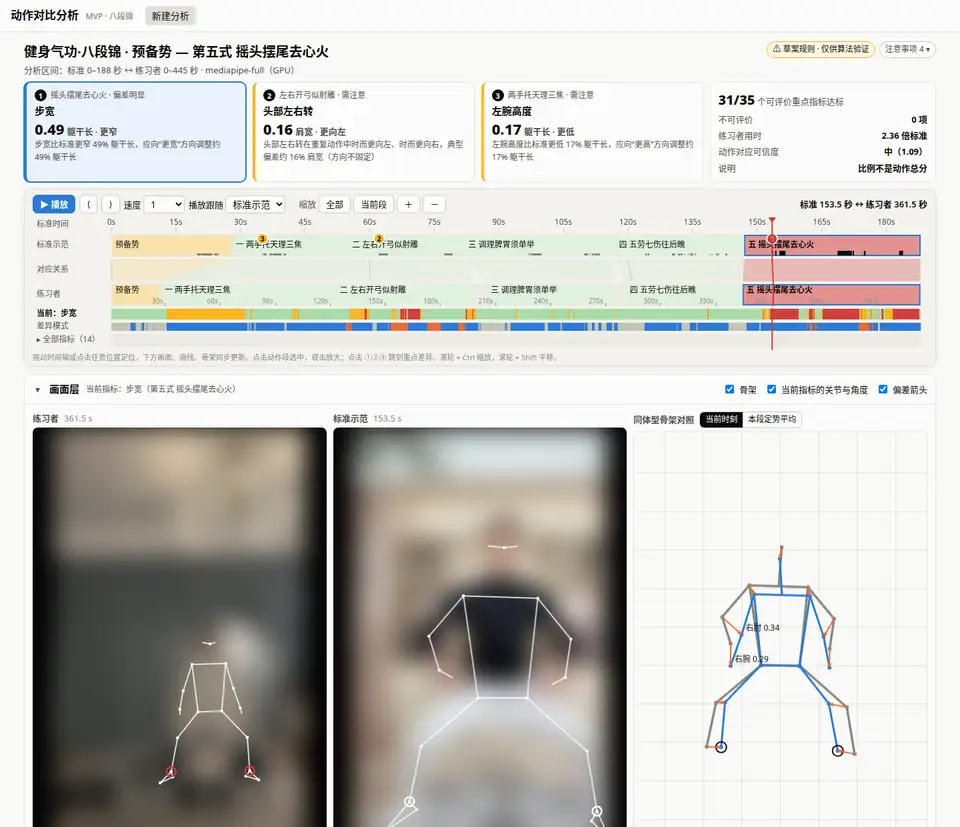
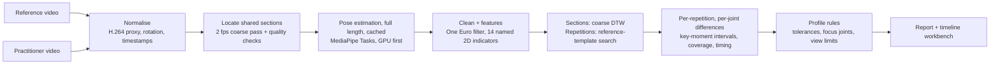
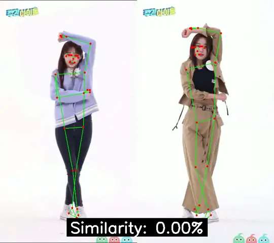

# MotionCoach

**Compare a practitioner's video with a reference performance — joint by joint, moment by moment.**

MotionCoach is a motion-comparison engine with application layers on top. You give it a reference
video and a practitioner video. It finds the stretch of movement the two share, matches each moment
of the practitioner to the same phase of the reference (even when tempo and repetition counts
differ), and reports signed per-joint differences together with how much evidence supports each
one. Results open in a timeline workbench modelled on video-editing software. The first application
is **Baduanjin** (八段锦, a traditional Chinese qigong routine). The project began as *DanceBattle*,
an audio-aligned dance comparison demo, which is still included.



<sub>Demo recorded on the real workbench. Video pixels are blurred on purpose; skeletons and analysis
layers are shown as rendered. The UI is currently in Chinese.</sub>

Project page: <https://bmprojects.github.io/MotionCoach/>

## What it does

- **Analyses only what both videos share.** One full-length pose pass per video (cached, so any
  later interval is a slice) is subsampled to 2 fps to locate every section of the routine in the
  practitioner video and check it: is the person detected, are the feet visible,
  is there a cut or zoom in the reference, is the correspondence reliable? Fine analysis runs only on
  the longest continuous stretch that passes. You can also pick sections or give a manual time range.
- **Matches repetitions, not frames.** A mirror-invariant coarse DTW finds each section; inside it,
  every reference repetition (annotated once per reference video) is searched in the practitioner's
  section with a slope-constrained subsequence DTW, so six practice repetitions each map onto the one
  demonstration without any frame absorbing a stretch of the other video. Playback follows the
  practitioner and replays the matching demonstration for every repetition. Differences in shape and
  in timing are reported separately. The method was chosen by a side-by-side study against the
  earlier approaches (`docs/ALIGNMENT_STUDY.md`).
- **Reports evidence, not a magic score.** It measures 14 interpretable 2D indicators (joint angles,
  wrist height, trunk lean, head turn, stance width, hip height) and gives signed differences at
  key moments, coverage, and a status for each one. When there is too little valid data the status is
  *not evaluable*; when the correspondence is unreliable it is *uncertain* — never a silent zero or a
  silent pass. Pass rates always show their denominator.
- **Shows its work.** The timeline workbench puts the reference timeline on top, the practitioner
  timeline below it, and correspondence bands between them. Status strips mark every indicator over
  time, issue markers flag the largest differences, and dragging the playhead drives synced video with
  joint and angle overlays, a body-normalised skeleton with difference vectors, and indicator curves
  on the same time axis.
- **Keeps algorithms swappable.** End users run one deployment-chosen model: MediaPipe Pose Landmarker
  (GPU first) by default, RTMW-l on the GPU analysis server (`MOTIONCOACH_BACKEND`, the accuracy/speed balance), with section bounds
  optionally taken from another model (`MOTIONCOACH_BOUNDS_BACKEND`). Developers can
  benchmark RTMPose / RTMO / RTMW / RTMW3D (rtmlib, ONNX Runtime CUDA) and YOLO11 / YOLO26 on
  *identical frames*. The benchmark reports speed, stability, and model-to-model measurement differences
  (median / P95 / share of frames beyond tolerance).

## How it works



The code is layered so new applications are mostly configuration:

| Layer | Path | Responsibility |
|---|---|---|
| Engine | `src/motioncoach/engine/` | Pose-sequence contract, features, alignment, comparison, normalised skeletons, deviation clustering. Pure NumPy/SciPy/Numba, no IO |
| Perception | `src/motioncoach/perception/` | Backend adapters, a shared sampling loop (absolute *k/fps* grid), GPU detection and fallback, the algorithm registry |
| Media | `src/motioncoach/media/` | Probing, normalisation, scene-cut detection, content-addressed pose cache |
| Apps | `src/motioncoach/apps/` | Profiles (rules as YAML), reference assets, scope selection, evaluation, orchestration, benchmark |
| Service / Web | `src/motioncoach/service/`, `src/motioncoach/web/` | FastAPI job service and a build-free web client |
| Legacy | `src/dancebattle/` | The original DanceBattle dance demo (CLI + PySide6 GUI) |

A new discipline needs a `profile.yaml` (indicators, tolerances, focus joints per section, what a
given camera view cannot measure) and an annotated reference asset (`references/*.yaml`).

## Quickstart

Requirements: Python 3.12, [uv](https://docs.astral.sh/uv/), FFmpeg. An NVIDIA GPU is optional.

```bash
uv sync                                   # core: MediaPipe backend + web service
uv run motioncoach serve                  # http://127.0.0.1:8765
```

Command line:

```bash
uv run motioncoach analyze --reference baduanjin_demo_a --user path/to/practice.mp4 --mirrored yes
uv run motioncoach analyze --reference baduanjin_demo_a --user practice.mp4 --scope segments --from s3 --to s4
uv run motioncoach analyze ... --scope manual --from s3 --to s4 --user-start 200 --user-end 357
uv run pytest
```

> The two Baduanjin sample videos used during development are **not** part of this repository (they
> show identifiable people). Point `references/baduanjin_demo_a.yaml` at your own licensed reference
> video and annotate its sections.

### Developer tools

```bash
uv sync --extra rtm --extra yolo          # rtmlib + onnxruntime-gpu (CUDA 13), Ultralytics
uv run motioncoach backends               # registry: availability, 2D/3D, GPU conditions, candidates
uv run motioncoach bench --reference baduanjin_demo_a --user practice.mp4 \
    --scope segments --from s3 --to s4 --backends mediapipe-full,rtmw-l,rtmw3d-x,yolo26m-pose
uv run motioncoach group --reference baduanjin_demo_a --video class.mp4   # several people (needs --extra rtm):
    # identities, performer screening, one report per performer, sync/consistency (docs/MULTI_PERSON_DESIGN.md)
MOTIONCOACH_DEV=1 uv run motioncoach serve    # exposes backend choice and the benchmark page
MOTIONCOACH_DEVICE=cpu uv run motioncoach ... # force CPU for reproducibility checks
```

## Pose backends

| Backend | Output | Role | GPU path | Licence |
|---|---|---|---|---|
| MediaPipe Pose Landmarker (lite / full / heavy) | 33 points + hip-centred 3D estimate | **Default** when unset (full); full for section bounds on the GPU server; lite for the person check | GPU delegate via EGL; Google documents Ubuntu only, so the adapter selects the NVIDIA EGL vendor and falls back to CPU | Apache-2.0 |
| RTMPose-m/x, RTMO-m | COCO-17 | Developer comparison | onnxruntime-gpu CUDA EP | Apache-2.0 |
| RTMW-l/x | COCO-WholeBody 133 (feet, hands) | RTMW-l: GPU-server default; others developer comparison | onnxruntime-gpu CUDA EP | Apache-2.0 |
| RTMW3D-x | 133 points + 3D (crop pixels + relative depth, not metric) | Developer comparison, 3D experiments | onnxruntime-gpu CUDA EP | Apache-2.0 |
| YOLO11m / YOLO26n/m-pose | COCO-17 | Developer comparison | PyTorch CUDA | AGPL-3.0 (commercial use needs a licence) |
| GVHMR | World-grounded SMPL motion (video level) | *Catalogued 3D candidate* | PyTorch CUDA | Research use; SMPL/SMPL-X need registration |
| SAM 3D Body | Single-image full-body mesh (MHR) | *Catalogued 3D candidate* | PyTorch CUDA | SAM License; gated weights |

A full benchmark of all twelve runnable backends on an RTX 4090 D, scored by what matters for the analysis
(repetition detection and key-moment correspondence against a hand annotation, keypoint noise during held
poses, occlusion in forward bends, hands/feet coverage, throughput and memory), is in
[`docs/POSE_BENCH.md`](docs/POSE_BENCH.md). In short: RTMW (whole-body) gives the best analysis results
and the only hand and foot keypoints; MediaPipe full is about 3× faster than RTMW-l and needs a fraction of
the memory. The reference and the practitioner must be measured with the same backend — conclusions shift
by up to a quarter of the indicator verdicts between models.

## Status and limitations

MotionCoach is a research prototype, **not** a validated coaching or assessment tool.

- The Baduanjin section boundaries, tolerances and focus joints are engineering drafts that a coach
  has not yet confirmed.
- Indicators are 2D and assume a frontal camera. Some movements (deep forward bends, turns) cannot be
  measured from the front and are marked as such. 3D outputs are stored but not yet scored.
- Repetitions and key moments of the reference are annotated by hand (draft, ±1 s, not yet confirmed
  by a coach); the method was validated on a single practitioner video only.
- Left/right cannot be inferred automatically for routines that alternate sides, so the user states how
  the video was recorded.
- No agreement study against expert ratings or motion capture has been done.
- Large, fast movements (deep bends with a swaying trunk) remain the weakest point of the 2D pose models;
  the experiment plan (cleaning ablation, failure diagnosis, a hard-pose validation set, a few candidate
  models) is in [`docs/EXPERIMENT_PLAN.md`](docs/EXPERIMENT_PLAN.md).
- Lengths are shown in body proportions; centimetres appear only when the practitioner states their height.

An index of all documents is in [`docs/README.md`](docs/README.md). Design notes, sample-video findings and the roadmap are in [`docs/ARCHITECTURE.md`](docs/ARCHITECTURE.md); the
reproducible iteration history (what was tried, measured and decided, with data fingerprints and commands)
is in [`docs/ITERATION_LOG.md`](docs/ITERATION_LOG.md) (both in Chinese).

## Legacy: DanceBattle

The original audio-aligned dance comparison is kept under `src/dancebattle` and runs on the current
MediaPipe Tasks API. Its output and scoring are unchanged.

```bash
uv sync --extra dance --extra gui
uv run python main.py --video-a assets/chuu.mov --video-b assets/cyves.mov --output-dir output
uv run python main_gui.py
```



## Acknowledgements

MotionCoach builds on the work of many projects:

- [Mruchus/dance-sync-analysis](https://github.com/Mruchus/dance-sync-analysis), which inspired the original DanceBattle.
- [Google MediaPipe](https://github.com/google-ai-edge/mediapipe), for the Pose Landmarker models and Tasks API.
- [OpenMMLab MMPose](https://github.com/open-mmlab/mmpose): RTMPose, RTMO, RTMW and RTMW3D.
- [rtmlib](https://github.com/Tau-J/rtmlib), which runs those models with ONNX Runtime and no MMCV dependency.
- [Ultralytics](https://github.com/ultralytics/ultralytics): YOLO11 and YOLO26 pose models.
- [GVHMR](https://github.com/zju3dv/GVHMR) (ZJU3DV) and [SAM 3D Body](https://github.com/facebookresearch/sam-3d-body) (Meta), catalogued as 3D candidates.
- [ONNX Runtime](https://onnxruntime.ai/), [PyTorch](https://pytorch.org/), [NumPy](https://numpy.org/), [SciPy](https://scipy.org/), [Numba](https://numba.pydata.org/), [OpenCV](https://opencv.org/), [FFmpeg](https://ffmpeg.org/).
- [FastAPI](https://fastapi.tiangolo.com/) and [Uvicorn](https://www.uvicorn.org/), for the service layer; [librosa](https://librosa.org/), [MoviePy](https://zulko.github.io/moviepy/) and [PySide6](https://doc.qt.io/qtforpython-6/), for the legacy demo.
- [Playwright](https://playwright.dev/), used to verify the web client in a real browser.

## Licence

The MotionCoach source code is released under the MIT Licence (see `LICENSE`). Models and weights
downloaded at runtime keep their own licences. Note in particular Ultralytics YOLO (AGPL-3.0), the SMPL
family of body models, and SAM 3D Body (SAM Licence).
