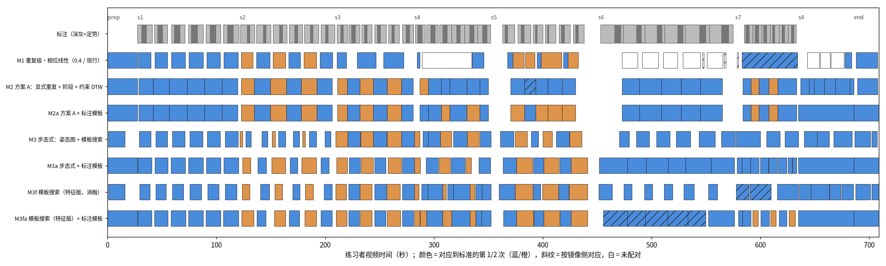
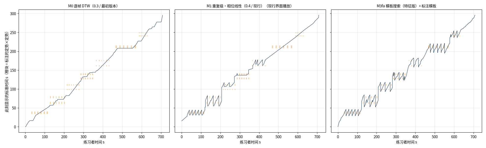

# 动作对应方法对比研究（2026-10-20）

> 目的：在**不改动现行分析流程**的前提下，用同一份姿态数据、同一组段边界和同一套评价，比较逐帧 DTW（0.3）、现行重复级方法（0.4）、方案 A（显式重复 + 阶段 + 约束 DTW）与“步态识别式”方案（姿态图 + 周期模板搜索）。
> 代码：`src/motioncoach/research/`（服务不调用）；复现：`uv run python -m motioncoach.research.align_compare`，输出 `data/research/align_compare/{report.md,results.json,*.png}`。

## 1. 结论

1. **0.4 版在默认播放（以标准为准）下确实比 0.3 版差**：已配对重复之间的时间被线性插值，练习者画面有 12% 的时间以 >4 倍速快进；第六、七式完全没有配对。0.3 版的问题则在另一侧：以练习者为准播放时标准画面最长停滞 76 秒。两者都没有解决“1 次示范 ↔ 6 次练习”。
2. **决定性的改进来自“周期模板搜索 + 标注的标准模板”**，不是图像化的姿态表示：用标准每次重复（标注的起止）作模板，在练习者段内做带斜率约束（0.5–2 倍）的子序列 DTW 搜索，练习者重复 F1 从 0.55 提高到 0.92，定势对应命中率从 64% 提高到 98%（以练习者为准）/ 从 58% 提高到 92%（以标准为准），左右交替对应正确率从 71% 提高到 96%，段内不再出现停滞。
3. **步态式姿态图本身没有带来优势**：在同样的模板搜索下，姿态图与现有 14 维特征的重复检出相当（F1 0.91 vs 0.92），但定势命中、左右交替更差（90%/83%/77% vs 98%/92%/96%）。原因是姿态图不含头部朝向（第四式“往后瞧”看不见）、不区分左右关节（左右交替的式容易对到另一侧）。它在节奏一致的舞蹈对照上略稳（P90 误差 0.15 s vs 0.75 s）。步态识别真正可借鉴的是“按周期整体匹配”，这一点已在模板搜索中体现；图像化表示若要有优势，需要可学习的嵌入和训练数据，目前不具备。
4. **标准模板的自动切分是最弱的一环**：所有自动切分变体都会把标准的某几式切错（第二式切成 3 段、第六式切成 3 段、第七式两次合成一次），对应质量随之大降（M3f F1 0.64 → 标注模板 M3fa 0.92）。标准视频只需由教练标注一次（每式每次重复的起止与定势区间），这正是方案 A 中“阶段边界由教练标注”的要求。
5. **One Euro 滤波**把关键点抖动降低约 57%（练习者 0.0061 → 0.0026），对模板搜索有小幅帮助（M3fa F1 0.88 → 0.92，定势命中 90% → 98%），对其他方法基本中性。
6. **HSMM 段边界（方案 C）在本样例上没有优于现行粗 DTW**（平均误差 3.0 s vs 2.8 s）；两者都在“第八式 ↔ 收势”（都以站立为主）上出错（15–23 s），且这一边界在两台 GPU 上不稳定（相差 16 s）。暂不采用。
7. **仅改播放策略就能消除最明显的“抖动/卡住”**：同样用 0.4 的对应结果，把“插值快进/原地等待”换成“循环/跳转”（重复内按对应播放，重复之间 1 倍速过渡并跳回模板或跳过多做的重复），以练习者为准的最长停滞从 47.8 s 降到 0，以标准为准的 >4 倍速快进从 12% 降到 0。

## 2. 数据、基准与评价

- 样例：标准 `Weixin…221512`（295.8 s）↔ 练习者 `Weixin…222517`（708.7 s，镜像录制），MediaPipe Pose Landmarker full，10 fps。舞蹈对照：chuu ↔ cyves 片段 3–5，外部真值为音频对齐（cyves = chuu − 4.55 s）。
- 基准标注：`references/annotations/baduanjin_demo_a__weixin_222517.yaml`。按 1 fps 带时间戳缩略图逐秒看片，第四式（头部转动）与第七式（冲拳）用 2 fps 放大核对；精度约 ±1 s，**由 Claude 标注，尚未经人工/教练核对**。第一至第七式：练习者每式 6 次（共 42 次），标准对称式 1 次、左右交替式 2 次（共 12 次）。
- 现行参考资产的分段与实际有出入：`baduanjin_demo_a.yaml` 中第六式止于 217 s，实际起身上举并下落到约 226 s（已在标注中修正，现行资产未改）。
- 评价（`research/metrics.py`）：
  - 重复检出：与标注 IoU ≥ 0.5 的一一匹配，F1、边界误差、次数误差；
  - **定势对应命中**：把标注的定势中心经方法给出的播放映射换到另一侧，看是否落在对方的标注定势区间内（±0.5 s），分“以练习者为准”和“以标准为准”两种播放；
  - 左右交替：相邻两次练习者重复是否对应到标准的不同侧；
  - 段内平衡：已配对重复内部局部速度比在 0.5–2 倍内的比例、最长停滞、一对多（≥4 个练习者采样落到同一标准采样）的练习者时间占比；
  - 播放：整个分析区间的局部速度比、最长停滞、>4 倍速快进、跳转次数；
  - 骨架残差：对应帧同体型骨架的平均关节距离（躯干长），与方法所用表示无关。

## 3. 方法

| 代号 | 方法 | 要点 |
|---|---|---|
| M0 | 逐帧 DTW（0.3） | 段内固定端点 DTW；没有“重复”概念 |
| M1 | 重复级·相位线性（0.4，现行） | PCA 周期信号 → 峰值核心区间 → 与标准重复按相位线性对应 |
| M2 | 方案 A | 镜像不变周期信号；按自相关周期切分到谷底；定势 = 峰附近低速平台；起势/定势/还原三阶段分别做斜率约束 DTW（位置 + 速度特征） |
| M3 | 步态式 | 同体型骨架渲染为 32×40 姿态图（余弦距离）；标准重复由“离开起始姿势的距离”切分；以标准重复为模板，在练习者段内做多速率、斜率约束的子序列 DTW 搜索，搜索路径即重复内对应 |
| M3f | 模板搜索（特征版） | 与 M3 相同的搜索，表示换成 14 维特征 + 速度（消融：表示 vs 匹配方式） |
| 后缀 a | 标注模板 | 标准侧的重复与定势取自标准视频的标注；练习者侧仍全自动 |

M2/M3 的通用规则：标准已示范左右两侧时不允许“镜像对应”（避免练习者的左侧对到标准的右侧）；相邻出现可在两端重叠不超过模板长度的 15%；播放采用“循环/跳转”策略。

## 4. 结果（段边界取标注，只比较段内对应）

| 方法 | 重复 F1 | 次数误差 | 定势命中·练习者为准 | 定势命中·标准为准 | 左右交替 | 播放·练习者为准 最长停滞 s | 播放·标准为准 速度在 0.5–2× | 快进 >4× | 骨架残差 |
|---|---|---|---|---|---|---|---|---|---|
| M0 逐帧 DTW（0.3） | — | — | 26% | 75% | — | 76.1 | 38% | 0% | 0.199 |
| M1 现行（现行界面播放） | 0.55 | 1.7 | 64% | 58% | 71% | 47.8 | 36% | 12% | 0.165 |
| M1 现行（循环/跳转播放） | 0.55 | 1.7 | 57% | 67% | 71% | 0.0 | 55% | 0% | 0.165 |
| M2 方案 A | 0.77 | 0.4 | 67% | 67% | 76% | 2.4 | 65% | 0% | 0.179 |
| M2a 方案 A + 标注模板 | 0.77 | 0.4 | 62% | 75% | 100% | 2.3 | 77% | 0% | 0.195 |
| M3 步态式 | 0.61 | 1.0 | 83% | 83% | 80% | 0.6 | 65% | 0% | 0.121 |
| M3a 步态式 + 标注模板 | 0.91 | 0.3 | 90% | 83% | 77% | 1.9 | 70% | 1% | 0.118 |
| M3f 模板搜索（特征） | 0.64 | 0.9 | 88% | 92% | 88% | 1.0 | 68% | 0% | 0.118 |
| **M3fa 模板搜索（特征）+ 标注模板** | **0.92** | 0.4 | **98%** | **92%** | **96%** | 1.9 | 73% | 1% | 0.122 |

端到端（段边界由现行粗 DTW 自动给出）：M1 不变；M3fa F1 0.95、定势命中 98% / 92%，与标注段边界下基本一致。完整表格（含 HSMM 段边界、滤波消融、每式检出次数）见 `data/research/align_compare/report.md`。

每式检出的练习者重复（配对/检出，标注各 6 次）：

| 方法 | 第一式 | 第二式 | 第三式 | 第四式 | 第五式 | 第六式 | 第七式 |
|---|---|---|---|---|---|---|---|
| M1 现行 | 6/6 | 6/6 | 3/3 | 2/3 | 7/7 | 0/7 | 1/2 |
| M2a | 6/6 | 6/6 | 6/6 | 6/6 | 5/5 | 5/5 | 5/5 |
| M3a | 6/6 | 6/6 | 6/6 | 6/6 | 6/6 | 6/6 | 8/8 |
| M3fa | 6/6 | 6/6 | 6/6 | 8/8 | 6/6 | 6/6 | 7/7 |

舞蹈对照（节奏一致，线性映射即为真值）：M1 中位误差 0.05 s（采样分辨率）；M2/M3 0.05 s（P90 0.15–0.21 s）；M3fa 0.05 s（P90 0.75 s）；M0 以练习者为准 0.70 s。新方法在“简单情形”上不退化。

跨 GPU（开发机 RTX 3050 ↔ GPU 服务器 RTX 4090 D，各自独立提取姿态）：M3a / M3fa 十个段的检出次数完全一致，F1 相同（0.91 / 0.92），定势命中 98% vs 95%；M1 只有 7/10 段次数一致。

## 4b. 表示消融：关节特征 vs 关键点坐标（2026-10-21 晚）

**问题**：重复对应用 14 维特征（9 个角度：双肘、双肩、双髋、双膝、躯干侧倾；5 个按身体尺度归一的位置：双腕高度、头部左右转、步宽、髋部高度），是否还应比较关键点坐标？

**设置**
- 匹配方法、停止规则与 M3fa 完全相同，只换表示：
  - **M3ca**：同体型骨架坐标。练习者骨长按标准缩放，髋中点为原点，躯干长为单位；13 个关节 × 2 维，每 0.15 躯干长计为一个容差单位，再加速度项；镜像 = 水平翻转并交换左右关节。
  - **M3fca**：特征与坐标拼接，两组在代价中权重相同。
- 两个姿态算法（RTMW-x、MediaPipe full）各跑一遍，n3 视频缓存。
- 结果目录：`data/remote/study-20261021-200258`（RTMW-x）、`study-20261021-200430`（MediaPipe full）、`study-20261021-200546`（RTMW-x + MediaPipe 段边界）。

| 表示（标注模板） | 姿态 | 重复 F1 | 定势命中 练习者/标准为准 | 左右交替 | 舞蹈 P90 误差 s 练习者/标准为准 |
|---|---|---|---|---|---|
| 特征 M3fa（生产） | RTMW-x | **0.98** | 95% / **100%** | **100%** | 1.15 / 0.85 |
| 坐标 M3ca | RTMW-x | 0.94 | 95% / 83% | 96% | **0.15 / 0.15** |
| 特征 + 坐标 M3fca | RTMW-x | **0.98** | **100%** / 92% | **100%** | 0.15 / 0.20 |
| 特征 M3fa（生产） | MediaPipe full | **0.93** | **98% / 100%** | **91%** | 0.25 / 0.23 |
| 坐标 M3ca | MediaPipe full | 0.86 | 90% / 83% | 73% | 0.15 / 0.15 |
| 特征 + 坐标 M3fca | MediaPipe full | 0.87 | 90% / 92% | 77% | 0.15 / 0.18 |

（段边界 = 标注。段边界自动时排序相同。）

**结论**
1. **八段锦的重复对应不需要再比较坐标**。两种姿态算法下特征都优于纯坐标（F1 0.98 vs 0.94、0.93 vs 0.86；左右交替 100% vs 96%、91% vs 73%）。拼接后在 RTMW-x 上与特征持平（定势命中一升一降），在 MediaPipe 上明显变差，没有稳定收益。原因：
   - 坐标对体型与站位的残差敏感；
   - 不显式表达头部朝向；
   - 左右交替式中“同侧”的区别在坐标上不如角度明显。
2. **舞蹈类快速、全身同时运动的项目，坐标明显更好**（P90 0.15 s vs 0.25–1.15 s）：14 维特征是为八段锦挑选的，覆盖不了舞蹈动作的全部变化。表示应随项目配置：舞蹈 profile 可改用坐标或拼接，八段锦保持特征。**尚未实施**。
3. **判定层只用特征**：规则、容差、文字建议都是针对角度和身体比例写的，教练也按这些描述动作。坐标只用于呈现，包括同体型骨架对照和骨架残差，不参与判定。

## 5. 局限

- 只有一对视频；标注由同一标注者（Claude）完成，±1 s，未经人工核对。
- M2/M3 的若干规则（左右两侧都示范时禁用镜像、端部重叠容差、取最短强周期、阶段长度保护）是在观察本样例结果后确定的，结果偏乐观；需要在新采集的练习者视频上做留出验证。
- “a”变体以标准视频的标注作为输入，因此其标准侧检出指标按构造为满分；练习者侧指标不受影响。
- 姿态图未包含耳/眼关键点，头部转动不可见；若要继续评估步态式表示，应先补上头部朝向。

## 6. 建议（2026-10-21 已按第 1、2 条接入正式流程，见 ARCHITECTURE §16）

1. 生产流程改用 **M3fa**：标准视频的重复与定势由教练标注一次（YAML，格式同本研究的标注文件）；练习者侧用特征模板搜索 + 斜率约束 DTW；One Euro 滤波；“循环/跳转”播放；练习者重复多于标准时默认以练习者为准播放，并显示“练习者第 k/N 次 ↔ 标准第 j 次”。
2. 即便暂不换算法，也可先只改播放策略（第 1 节第 7 条），成本低、效果直接。
3. 段边界暂保留现行粗 DTW；第八式与收势需要标注或额外规则（如提踵的竖直位移）。
4. 新采集的数据用作留出验证：为每位练习者标注一份同格式文件，运行同一脚本即可得到同口径的结果。
