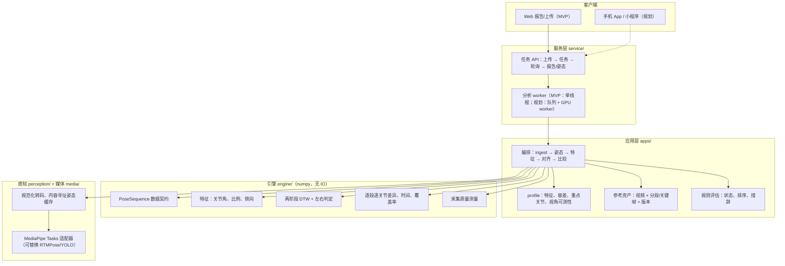

# 动作比较引擎与八段锦 MVP：总体架构

> 状态：初步规划 + 可运行 MVP（2026-10-19 第二次更新：GPU 优先执行、3D 候选算法入库、默认仅 MediaPipe、结果有效性门控、时间轴工作台前端、旧舞蹈演示恢复）。

## 1. 定位

- **共用的是测量与比较能力**：姿态数据契约、质量判断、时间对应、逐关节差异。
- **评价属于应用**：容差、重点关节、视角可测性、反馈措辞由各应用（八段锦、舞蹈……）以配置提供。
- 引擎输出的是**证据**（有符号差值、覆盖率、时间、对齐可信度），不是一个“相似度百分比”。缺失数据输出“不可评价”，不计为 0 分。
- 初期保持**一个仓库、模块化后端、独立分析进程**；规模增长后优先独立扩展推理与视频处理。

旧的 `src/dancebattle` 保留为舞蹈演示，未改动；新代码在 `src/motioncoach`。旧实现的已知问题（关节对应错位、镜像/旋转得满分、宽高比失真、帧率错配、缺失记 0、`mp.solutions` 在 mediapipe ≥1.0 已移除）均已在新引擎中按设计规避，并有回归测试。

## 2. 样例视频暴露的主干技术问题

两段八段锦视频（`assets/` 中两个 Weixin 视频）作为“标准 A”和“用户 B”：

| 现象 | 实测 | 架构对策 |
|---|---|---|
| 编码与方向各异 | A：HEVC 544×960；B：H.264 存储为 568×320，带 90° 旋转元数据 | **入库规范化**：统一转码为 H.264 代理（旋转写入像素、保留时间戳），分析与播放使用同一文件，浏览器也能播放 HEVC 来源 |
| 节奏差异大 | B 总时长约为 A 的 2.4 倍，各式重复次数不同 | 不能用单一时间偏移；**两阶段 DTW**（见 §5） |
| 首尾跳过 | 单阶段子序列 DTW 曾丢弃 B 的前 163 s 和后 223 s | 首尾“无关片段”按帧计代价（`skip_cost`），迫使对齐覆盖完整练习 |
| 左右镜像 | B 是前置摄像头镜像录制（地垫数字反向）；但左右交换前后的对齐代价比为 **1.00** | 八段锦左右交替，镜像在时间上等价于半周期相移，**无法从动作判断**。前端必须询问录制方式；自动判断只在代价差明显时生效 |
| 关键姿态选择 | 按“最低速度”选的帧落在过渡/预备姿势（如攒拳前的抱拳），给出 43° 的伪偏差 | 改为“低速 + 最偏离中立站姿 + 排除段首尾”；**最终应由教练标注定势关键帧** |
| 示范视频取景 | A 未检测到硬切换（场景分数 ≤0.02），直立帧人体尺度稳定；约 23% 时间身体触及画面边缘。（早先从缩略图推断的“推近镜头”经测量不成立，是马步降低重心造成的观感） | 比例特征除以**整段躯干长中位数**，不逐帧归一化；剪辑/推拉在区间选择中自动检测（场景切换 + 直立躯干尺度） |
| 用户画质 | B 为 320×568、宽松服装、人物约占画高一半 | 质量警告进入报告；容差不低于测量噪声 |
| 正面视角局限 | 两手攀足的前屈在正面视角严重透视缩短 | 配置中按“动作段 × 指标”标记“此视角不可测”，而不是给出错误数值 |

对齐结果（B 中各段起点，与人工粗标对比，人工标注本身约 ±10 s）：两阶段对齐后中位误差约 6 s，最大 19 s（收势；第八式与收势都以站立为主，提踵尚未测量）。关键姿态抽检：第五式步宽、第七式马步深度与肘角的配对帧均为同一动作阶段，偏差方向与画面一致。

## 3. 分层架构



| 层 | 目录 | 负责 | 不负责 |
|---|---|---|---|
| 引擎 | `engine/` | 数据契约、特征、对齐、差异证据、骨架归一化、差异聚类、质量测量 | 是否合格、措辞、视频解码、模型加载 |
| 感知 | `perception/` | 统一后端接口 + 共用解码循环（绝对采样网格、时间窗、真实时间戳）；MediaPipe / rtmlib / Ultralytics 适配器；GPU 检测与回退（`gpu.py`）；算法库与候选 3D 技术登记（`registry.py`）；多人场景的目标人物选择 | 打分 |
| 媒体 | `media/` | 探测、规范化代理、场景切换检测、按时间窗取姿态与缓存 | 业务规则 |
| 应用 | `apps/` | profile、参考资产、**分析区间选择**、规则评估、编排、报告组装、**算法对比** | 底层几何 |
| 服务 | `service/` | 上传、任务、进度、报告/姿态/CSV/对比结果分发 | 教学标准 |
| 客户端 | `web/` | 拍摄引导、四页报告、算法对比页 | 重新计算误差和阈值 |

新增一个应用方向 = 新建 `apps/<name>/profile.yaml`（必要时加少量特征）+ 参考资产；引擎不出现“舞蹈”“八段锦”之类业务概念。新增一个姿态算法 = 在 `perception/` 写一个 `open / estimate / close` 适配器并登记到 `registry.py`。

## 4. 数据契约

**PoseSequence**（`engine/sequence.py`）
- `t`：真实时间戳（秒），严格递增——按时间而非帧号比较。
- `xy`：显示方向下的**像素坐标**（x、y 同尺度，角度不随画面宽高比失真）；缺失为 NaN。
- `conf`：逐关节置信度（各算法校准不同，`meta.conf_thr` 记录该算法的判定阈值）；`world`：模型估计的 3D 坐标（估计值，不当作测量真值）。
- `skeleton_name`：命名骨架（`mediapipe33`、`coco17`、`coco_wholebody133`）；特征按关节名取点，后端缺关节 → 特征缺失。
- `mirrored`、`meta`（算法、设备、权重版本、采样率、时间窗、推理耗时、来源哈希、预处理参数）。

**报告**（`motioncoach.report/0.2`，`data/jobs/<id>/report.json`）
- `scope`：分析区间（模式、理由、所选动作段、标准/用户时间范围、每段的合格检查与原因）。
- `quality`、`left_right`（交换代价比、逐段证据、采用的解释）、`timing`（整体用时比、对齐代价、方法）、`model`（算法、设备、ms/帧）。
- `segments[]`：时间范围、用时比、对齐代价、定势时刻、`features{}`（覆盖率、有符号均值、定势典型偏差、容差、状态、原因、修正文字）。
- `normalized`：逐时刻的标准/练习者归一化骨架（13 关节，躯干长单位）+ 每段定势平均骨架与偏差离散椭圆。
- `patterns`：逐时刻差异模式标签、各模式中心（原单位与容差单位）、占比、出现的动作段、典型时刻。
- `summary`、`series`（逐时刻标准值/对齐后的练习者值）；姿态叠加数据单独提供（`poses_{ref,user}.json.gz`）；`/api/jobs/<id>/export.csv` 导出逐时刻数据。

**缓存键**：源文件内容哈希 + 规范化版本 + 模型 ID（含权重）+ 采样率 + 时间窗；已缓存的全长结果可直接切出任意子区间。参考数据必须与生成它的模型版本绑定。

## 5. 分析流程

1. **入库**：ffprobe → 规范化代理（H.264/AAC、旋转写入、faststart、时间戳透传）。
2. **确定分析区间**（只在该区间做逐帧分析）：
   - `auto`：用轻量模型（MediaPipe lite）以 2 fps 粗扫两段视频，粗对齐整套动作，逐段检查：双方检测率 ≥ 90%、脚部可见 ≥ 60%、标准视频段内无剪辑/推拉（ffmpeg 场景切换 + 直立帧躯干尺度 p90/p10 ≤ 1.3）、粗对齐代价 ≤ 1.6、段用时与整体节奏相符（0.4–2.5 倍）；取**合格动作段中最长的连续一串**。
   - `segments`：用户指定动作段，粗扫只用于在练习者视频中定位。
   - `manual`：用户给定动作段与练习者视频起止秒，**不处理全长视频**。
3. **姿态**：所选算法在区间内按真实时间戳以 10 fps 采样；另取标准视频前 3 秒作为中立站姿（用于选定势）。
4. **清洗**：按该算法的置信度阈值屏蔽 → ≤0.4 s 缺口线性补齐（标记为插值）→ Savitzky–Golay 平滑；长缺口保持缺失。
5. **特征**（14 项，定义见报告“指标说明”）：左右肘、臂上举、髋、膝角；左右腕高度；躯干侧倾、头部左右转（按练习者自身左右定义符号）；步宽、髋部高度（躯干长单位）。
6. **对齐（两阶段）**：粗——镜像不变特征 + symmetric2 DTW + 首尾跳过代价 → 各段边界；细——每段内固定端点 DTW，“原样/左右交换”两种解释比较代价（或按用户声明）。
7. **比较**：对应时刻的 `delta = 练习者 − 标准`；按段统计覆盖率、有符号均值、定势典型偏差；**形态差异与时间差异分开报告**。偏差方向在重复中不固定时（左右交替），文字写“时而偏大、时而偏小”，不给单一方向的修正。
8. **归一化骨架**：两人换算到同一标准体型——髋中点为原点，以示范者躯干长为单位，练习者每根骨段保留自身的二维方向与透视缩短，只按“示范骨长中位数 / 练习者骨长中位数”缩放；剩余的关节偏移只反映姿势。
9. **差异模式**：每个时刻的 14 维差值除以容差；全部在容差内的时刻归为“接近标准”，其余用 k-means 聚类（k 由轮廓系数在 2–6 间选择），每类给出中心、占比、出现段落与典型时刻。
10. **规则**：按 profile 判定达标/需注意/偏差明显/无法测量/此视角不可测，排序生成数值修正文字。

## 6. 部署架构

| 阶段 | 形态 | 要点 |
|---|---|---|
| MVP（当前） | 单进程 FastAPI + 1 个分析线程 + 本地文件 | 区间粗扫（两段全长视频，2 fps，lite）约 37 s；区间内逐帧分析耗时与区间长度和算法成正比（见 §11）；姿态缓存后重算约 6 s |
| 受控试点 | API 服务 + 任务队列（如 Redis/RQ 或 Celery）+ 独立 worker；对象存储；数据库记录任务与参考版本 | 参考资产的粗扫与全长姿态离线预计算；上传直传对象存储；worker 隔离与重试；P95 等待时间与单任务成本作为容量依据 |
| 规模化 | 端侧推理（MediaPipe Web/Android/iOS 或 RTMPose ONNX/Core ML）上传关键点；服务端只做对齐、比较与存储；可选 GPU worker 做高精度/3D 复算 | 隐私（身体视频不出端）、带宽和成本显著下降；端侧与服务端模型版本必须一致 |

需要单独核查的授权：Ultralytics YOLO（AGPL-3.0/企业授权）、SMPL 系人体模型、SAM 3D Body 权重；MediaPipe、rtmlib 及其 RTMPose/RTMW 权重为 Apache-2.0。

## 7. 前端设计：以时间轴为主轴的工作台

报告页不再分页签，所有内容围绕**标准示范时间轴**组织，参考视频剪辑软件的“时间轴 + 预览层”交互，降低视频与数值割裂带来的来回切换：

1. **页头**：分析对象与区间、设备；“草案规则”“区间待核查”等提示常显，其余注意事项一键展开。
2. **重点发现条**：最多 3 张差异卡片（动作段、指标、典型偏差数值与单位、方向），右侧为“31/35 个可评价重点指标达标 · 另 N 项不可评价”等带分母的摘要，并注明“比例不是动作总分”。
3. **时间轴（吸顶）**：
   - 刻度为标准时间；**标准示范轨**显示动作段（按当前指标的段内状态着色）、定势时刻刻线和 ①②③ 重点差异标记；
   - **对应关系带**把每个动作段在两条轨道间连成梯形，并画出等间隔对应线——梯形越宽表示练习者越慢；
   - **练习者轨**按练习者自身时间显示同一组动作段和秒数；
   - **当前指标状态条**（达标为浅绿，需注意/偏差明显/对应不可靠/此视角不可测/缺失各有颜色）、**差异模式条**、可展开的 **14 项指标状态泳道**（展开后取消吸顶，避免遮挡下方内容）；
   - 播放头在练习者轨上折到对应时刻；拖动、点击定位，单击动作段选中、双击放大，Ctrl + 滚轮缩放、Shift + 滚轮平移，空格播放、左右键步进；播放限制在分析区间内。
4. **随播放头联动的层（可折叠）**：
   - **画面层**：练习者视频 | 标准视频 | 同体型骨架（三栏）；可分别开关骨架、当前指标关节与角度弧（显示角度值）、偏差箭头；“本段定势平均”显示所用样本数，椭圆注明为偏差分布而非测量精度；区间外显示“此时段未分析”。
   - **曲线层**：与时间轴共用同一水平坐标（同一视图范围、同一左侧标签栏宽度），标准/练习者曲线、允许偏差带、不可测斜纹、段界、定势标记、播放头；上方指标标签可快速切换，本段重点指标加粗。
   - **当前关注**：状态、修正文字或不可评价原因、此刻三值与本段典型偏差、计算口径（有效定势时刻数、覆盖率）；更多数据（当前时刻全部指标、动作段 × 指标矩阵、差异模式、区间选择理由、指标说明、导出与技术信息）默认折叠。
- **开发者模式**（`MOTIONCOACH_DEV=1`）才显示姿态算法选择与算法对比页；终端用户界面只运行默认 MediaPipe。
- 浏览器实测（系统 Chrome + Playwright，任务 `2e2bcc48ef6a`）：拖动定位后练习者视频与对应时刻一致；双击动作段缩放；指标泳道展开；播放 3 秒后两路视频仍按对应关系同步；播放到区间末端自动停止；420 px 宽无横向滚动；无页面脚本错误。暗色模式未做视觉验收。

## 8. 姿态算法库、GPU 与 3D 候选

**默认策略**：终端用户只运行 MediaPipe Pose Landmarker full（区间粗定位用 lite）；其他算法只用于开发者对比（CLI `motioncoach bench`，或开发者模式）。Web API 收到非默认算法请求时返回 403。

**GPU 条件（按各官方文档核实，并在本机 RTX 3050 4 GB / Debian 13 / 驱动 615 实测）**：

| 算法族 | 官方 GPU 条件 | 本机结果 |
|---|---|---|
| MediaPipe Tasks | Python `BaseOptions(delegate=GPU)`，官方声明“GPU 仅支持 Ubuntu”（[API 文档](https://ai.google.dev/edge/api/mediapipe/python/mp/tasks/BaseOptions)） | 默认 EGL 选中 Mesa 导致 `eglChooseConfig` 失败；指定 NVIDIA EGL vendor（`__EGL_VENDOR_LIBRARY_FILENAMES`，适配器自动设置）后可用：full 约 4–9 ms/帧（CPU 约 17–21 ms），关键点与 CPU 结果差约 0.0003（归一化坐标）。失败时自动回退 CPU 并在报告中注明。注：MediaPipe 会先尝试默认 EGL display 并打印一段 `eglGetDisplay() returned error` 堆栈日志，随后成功创建上下文，属非致命日志 |
| rtmlib（RTMPose / RTMO / RTMW / RTMW3D） | `onnxruntime-gpu`；≥1.27 的 PyPI 包基于 CUDA 13.0 + cuDNN 9.x，可用 `onnxruntime.preload_dlls()` 加载 NVIDIA pip 轮子中的库（[CUDA EP 文档](https://onnxruntime.ai/docs/execution-providers/CUDA-ExecutionProvider.html)）；rtmlib `device='cuda'` | rtmlib 依赖声明 CPU 版 `onnxruntime`，与 GPU 版模块同名冲突，已在 `pyproject.toml` 用 uv `override-dependencies` 排除；复用 torch cu130 自带的 CUDA 13 / cuDNN 9。会话确认运行在 CUDAExecutionProvider |
| Ultralytics YOLO | PyTorch CUDA 版本 | torch 2.14 + cu130，可用 |
| GVHMR（候选） | PyTorch CUDA；官方 Python 3.10 conda；可选 DPVO 需 CUDA 12.1 编译（[INSTALL](https://github.com/zju3dv/GVHMR/blob/main/docs/INSTALL.md)） | 未安装：需 SMPL/SMPL-X 注册下载与官方检查点 |
| SAM 3D Body（候选） | PyTorch CUDA；官方 Python 3.11 + Detectron2，未给出显存要求（[INSTALL](https://github.com/facebookresearch/sam-3d-body/blob/main/INSTALL.md)） | 未安装：权重需在 Hugging Face 申请批准；4 GB 显存是否足够未验证 |

设备类别写入模型 ID（如 `…/gpu`、`…/cuda`），因此 CPU 与 GPU 结果不会混用同一缓存；`MOTIONCOACH_DEVICE=cpu` 可强制 CPU 复核。

**3D 技术（备选）**：
- 已可运行、结果写入 `world` 字段但暂不参与评分：MediaPipe 世界坐标（髋部为原点，米制估计）、RTMW3D（x/y 为模型裁剪框像素、z 为相对深度，**非米制**）。
- 已登记、待接入：GVHMR（视频级、重力对齐世界坐标、SMPL 关节，适合转体/前屈等正面 2D 不可测指标）、SAM 3D Body（单图网格恢复，需逐帧运行再时序平滑）。`motioncoach backends` 列出其缺失条件；接入方式为新增“片段级”适配器（输入视频片段，输出带 3D 关节的 PoseSequence），再为 3D 特征单独定义角度与容差。

## 9. 结果有效性与可复现性（本轮修正）

- **采样一致**：所有运行使用绝对采样网格 k/fps，全长缓存切片与区间重采样取到同一批帧；缓存键加入采样版本（`g2`）。对比实验会校验各算法输入帧完全一致。
- **判定门控**：段内状态需要“定势时刻”本身有足够有效样本（覆盖率 ≥ 60% 且 ≥ 3 个），否则为“不可评价”；段的动作对应可信度低时，状态为“对应不可靠”，保留数值但不判定、不给修正方向。达标比例只以可评价指标为分母，并单列不可评价数量。
- **左右**：录制镜像与镜像练习是两个独立交换，两者同时成立时相互抵消（4 种组合有测试）。
- **聚类**：“此视角不可测”按缺失处理；差值裁剪到 ±4 个容差以免识别异常主导；占比 < 2% 的簇报告为“离群时刻”；同时给出“标准进程占比”和“练习者时长占比”。
- **定势样本统一**：段内统计、平均骨架、偏差分布使用同一全部定势样本集合。
- **无合格区间**：自动模式下不再静默选取，而是标记“区间待人工核查”。
- **对比统计**：算法间差异给出中位数、P90/P95、超容差比例（标准与练习者视频各一套），速度在当前设备上实测而非读缓存。

## 10. 当前 MVP 的边界

- 2D 正面指标；3D 输出尚未参与评分。
- 定势为启发式选择；未做逐次重复级比较——练习者多做的重复会被拉伸映射。
- 左右方向对交替型套路无法自动判断，依赖用户选择。
- 提踵、手型、眼神、呼吸节律未测量；多人场景只按“与上一帧框重叠/最大框”选目标人物。
- 第八式与收势都以站立为主，粗对齐边界不准；第六式前屈朝向镜头会让躯干在二维中缩短，被误判为“推拉镜头”（该段同时因对应可信度低被排除）。
- 手动模式跳过全长粗定位、精分析只在指定区间，但入库时仍会把整段视频转码为规范化代理。
- 自动选区间会排除“对应关系不可确认”的动作段，其中可能包含真实偏差大的动作，排除原因已逐段公开。
- 阈值与分段为草案；尚无与教练评分或动捕真值的一致性验证。

## 11. 路线图（按验收证据推进）

| 检查点 | 交付 | 证据 |
|---|---|---|
| C1 参考资产 | 教练确认的分段、定势关键帧、重点关节与容差；正/侧双视角标准 | 标注文件 + 教练签核（研究员问卷 C、D 部分） |
| C2 重复级比较 | 段内重复切分，逐次与标准周期对齐；“漏做/多做”检测 | 人工标注的重复边界对比 |
| C3 可信度验证 | 多人、多设备、多视角数据集（含故意错误动作）；角度误差、误报/漏报、覆盖率 | 独立于调参人员的验收集；动捕同步采集 |
| C4 算法选型 | 在 C3 数据上比较各姿态算法与动捕的误差，选定端侧与服务端算法 | `motioncoach bench` + 金标准误差 |
| C5 侧面/3D | 侧面拍摄 profile；评估 3D 提升对膝、髋、前屈的改善 | 与动捕或多视角真值对比 |
| C6 服务试点 / 端侧 | 队列 + worker + 对象存储 + 鉴权；Web/手机端姿态推理 | P95 处理时间、失败恢复、单任务成本、端侧一致性 |

## 12. 运行

```bash
uv sync --extra rtm --extra yolo   # Python 3.12；rtm 安装 onnxruntime-gpu（CUDA 13），yolo 安装 Ultralytics
uv run pytest                      # 引擎与规则回归测试（旧舞蹈烟雾测试需 RUN_MEDIAPIPE_TEST=1）
uv run motioncoach backends        # 算法库：可用性、维度、GPU 条件、候选技术缺失项
uv run motioncoach analyze --reference baduanjin_demo_a \
    --user "assets/Weixin Videos2026-10-18_222517_138.mp4" --mirrored yes            # 默认 MediaPipe（GPU 优先）
uv run motioncoach analyze ... --scope manual --from s3 --to s4 --user-start 200 --user-end 357
uv run motioncoach bench --reference baduanjin_demo_a --user ... --scope segments --from s3 --to s4 \
    --backends mediapipe-full,rtmw-l,rtmw3d-x,yolo26m-pose                          # 开发者对比
uv run motioncoach serve                         # http://127.0.0.1:8765（终端用户界面）
MOTIONCOACH_DEV=1 uv run motioncoach serve       # 开发者模式：可选算法 + 算法对比页
MOTIONCOACH_DEVICE=cpu uv run motioncoach ...    # 强制 CPU 复核
```

旧舞蹈演示（`src/dancebattle`）：`uv sync --extra dance --extra gui` 后运行 `python main.py --video-a assets/chuu.mov --video-b assets/cyves.mov` 或 `python main_gui.py`。已改用 MediaPipe Tasks 接口（mediapipe ≥1.0 移除了 `mp.solutions`），输出格式与原版一致；评分逻辑保持原样（未修正其已知缺陷）。

运行数据位于 `data/`，模型位于 `models/` 与 `~/.cache/rtmlib`，均不入库。

## 13. 姿态算法对比（样例视频，第三—四式，GPU）

同一区间（标准 82–147 s ↔ 练习者 201–357 s，10 fps）、**完全相同的输入帧**（标准 650 帧、练习者 1,565 帧，已校验）。完整结果：`data/bench/s3-s4/bench.md`，开发者模式网页可查看。

| 算法 | 设备 | ms/帧 | 抖动 ×1000（标/练） | 脚部可见（练习者） | 与基线结论一致 |
|---|---|---|---|---|---|
| mediapipe-full（默认） | GPU | 8–9 | 5.7 / 8.4 | 100% | — |
| mediapipe-heavy | GPU | 19–20 | 3.7 / 5.9 | 48% | 84% |
| rtmw-l（133 点） | CUDA | 46 | 11.7 / 15.4 | 100% | 93% |
| rtmpose-m | CUDA | 74 | 11.5 / 14.2 | 无足部点 | 93% |
| rtmw3d-x（3D） | CUDA | 152 | 9.1 / 11.8 | 100% | 89% |
| yolo26m-pose | CUDA | 35–36 | 4.3 / 6.2 | 无足部点 | 93% |
| yolo11m-pose | CUDA | 34 | 5.3 / 8.3 | 无足部点 | 89% |

同一帧上的算法间差异（标准视频；中位 / P95 / 超出允许偏差的帧比例）：

| 指标（容差） | full vs heavy | full vs rtmw-l | full vs yolo26m | rtmw-l vs rtmw3d-x |
|---|---|---|---|---|
| 右肘角（15°） | 2.7° / 9.5° / 0% | 4.7° / 15.6° / 6.9% | 3.1° / 9.4° / 0.9% | 3.1° / 11.8° / 1.1% |
| 左臂上举角（15°） | 1.3° / 3.7° / 0.8% | 1.9° / 5.1° / 0.8% | 2.3° / 5.0° / 0.8% | 1.9° / 3.5° / 0% |
| 左膝角（15°） | 0.7° / 2.3° / 0% | 0.6° / 2.6° / 0% | 1.0° / 2.9° / 0% | 0.7° / 2.1° / 0% |
| 髋部高度（0.15） | 0.07 / 0.11 / 0.3% | 0.04 / 0.08 / 0% | **0.14 / 0.20 / 29.5%** | 0.06 / 0.11 / 0% |

解读（仅限这两段样例视频，是算法之间的差异，不是对真实角度的误差）：

- 多数时刻各算法的关节角差异小于允许偏差，但**尾部不可忽略**：例如右肘 MediaPipe vs RTMW-l 的 P95 为 15.6°，约 7% 的帧超过 15°。
- 练习者视频（320×568、宽松服装）上差异更大：如右肘 MediaPipe vs RTMW-l 的 P95 达 21.6°，10% 的帧超出容差——画质越差，算法选择对结论的影响越大。
- **髋部高度在 MediaPipe 与 YOLO（COCO-17）之间存在系统差异**（29.5% 的帧超出容差），源于两套关键点对髋关节点的定义不同——标准与练习者必须用同一算法。
- GPU 带来 2–6 倍加速（RTMPose-m 450 → 74 ms/帧；RTMW-l 110 → 46 ms/帧；MediaPipe 21 → 9 ms/帧）。
- 抖动指标包含真实运动，过度平滑也会变小，只作同视频内的相对参考；MediaPipe-heavy 在低分辨率练习者视频上脚部可见率仅 48%，可见性阈值需按算法校准。
- 哪个算法更接近真实，需动作捕捉等金标准（研究员问卷 H 部分）。
