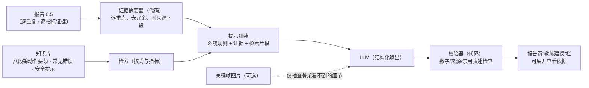
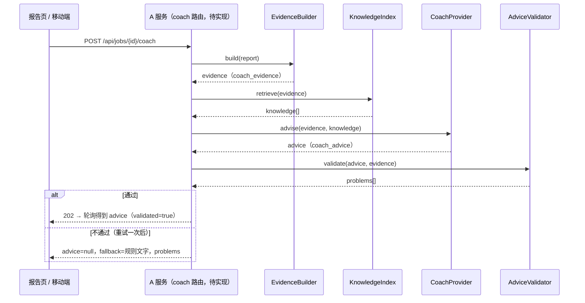

# LLM 辅助分析与建议：方案调研与初步设计（设计文档，2026-10-21）

> 目的：在现有“结构化测量证据”之上加入 LLM，把数值差异转成练习者能执行的指导，并与已有研究方案对比后选定初步路线。
> 状态：设计稿，未实施。下文调研信息均来自公开论文页面或摘要，标注“未核实”的内容只看过摘要或二手页面。

## 1. 调研：运动分析中的 LLM 方案

按“LLM 吃什么输入”分为三类。

### 1.1 端到端：视频（+ 姿态）→ 多模态模型 → 评语

| 工作 | 要点 | 与本项目的关系 |
|---|---|---|
| **ExpertAF**（CVPR 2025）（[论文页](https://openaccess.thecvf.com/content/CVPR2025/html/Ashutosh_ExpertAF_Expert_Actionable_Feedback_from_Video_CVPR_2025_paper.html)，[项目页](https://vision.cs.utexas.edu/projects/ExpertAF/)） | 输入视频与 3D 人体姿态，输出专家评语和“专家示范”可视化；训练数据来自 Ego-Exo4D 的技能视频与教练解说，报告优于强视觉语言基线 | 证明“可执行的纠正建议”可以学习，但需要大量专家解说数据，八段锦没有现成数据 |
| **Ego-Exo4D**（CVPR 2024）（[论文页](https://openaccess.thecvf.com/content/CVPR2024/html/Grauman_Ego-Exo4D_Understanding_Skilled_Human_Activity_from_First-_and_Third-Person_Perspectives_CVPR_2024_paper.html)） | 技能活动多视角数据集，含熟练度估计基准与教练对“怎么做”的口头解说 | 解说采集方式（教练边看边说）值得借鉴，用于积累八段锦评语数据 |
| **通用视频大模型**：Qwen3-VL（[技术报告](https://arxiv.org/pdf/2511.21631)）等 | 支持长视频与带时间戳的事件定位 | 可做抽查（手型、眼神等骨架看不到的细节）；对细微角度差（如 15°）的判断能力缺少公开证据 |
| **FitAQA**（arXiv 2608.08736，未核实细节）（[论文](https://arxiv.org/pdf/2608.08736)） | 评测多模态大模型在健身动作质量评估上的能力，指出现有视频基准对姿态与运动质量的敏感性证据有限 | 提示：不应让视频大模型直接给出数值结论 |

### 1.2 动作/骨架序列 → 专用模型 → 指导

| 工作 | 要点 | 与本项目的关系 |
|---|---|---|
| **CoachMe**（ACL 2025）（[arXiv](https://arxiv.org/abs/2509.11698v1)） | 基于参考动作，比较学习者与参考在时间和物理两方面的差异，生成教练式指导；适配花样滑冰与拳击，G-Eval 优于 GPT-4o（31.6% / 58.3%）；作者指出骨架难以表示手掌翻转等细节 | 思路与本项目“标准 vs 练习者”完全一致，可作为后期微调路线的参照 |
| **PoseFix**（ICCV 2023）（[arXiv](https://arxiv.org/pdf/2309.08480)） | 3D 姿态对 + 自然语言纠正描述的数据集；支持“根据两姿态差生成纠正文字” | 可借鉴“姿态差 → 纠正句”的表述方式与数据组织 |
| **MotionLLM**（arXiv 2405.20340，期刊版见 TPAMI）（[arXiv](https://arxiv.org/abs/2405.20340v1)） | 视频与动作序列联合建模的理解模型，配 MoVid 数据与基准 | 偏动作理解与描述，不是教练反馈 |

### 1.3 结构化测量证据 + 检索增强 + 通用 LLM（与本项目最接近）

| 工作 | 要点 | 与本项目的关系 |
|---|---|---|
| **SportsGPT**（arXiv 2512.14121）（[arXiv](https://arxiv.org/abs/2512.14121v2)） | 骨架序列 → 两阶段 DTW 对齐抽关键帧（MotionDTW）→ 与目标模型比较得到可解释指标（KISMAM）→ 基于 Qwen3 的检索增强生成训练建议（SportsRAG，6B token 领域问答库） | **流程几乎与本项目同构**（对齐 → 可解释指标 → LLM 建议），验证了这条路线；其知识库规模远大于本项目可得 |
| **Seeing and Saying Movement**（ACM，2026）（[论文页](https://dl.acm.org/doi/10.1145/3795011.3795054)） | 踢拳（kickboxing）：师生骨架逐关节比较，按误差着色，规则提示 + LLM 生成指导语；作者定位为设计探索，未证明学习收益 | 与工作台“骨架对照 + 文字”一致；提醒需另做学习效果评估 |
| **FitCoachPipe**（VAR 研讨会）（[论文 PDF](https://varworkshop.github.io/assets/pdf/14.pdf)，未核实） | 把“何时说”（3 秒冷却的发言门控）与“说什么”（微调 Qwen 基于姿态观测生成）分开 | 实时模式（移动端）可借鉴“时机与内容分离” |
| **攀岩反馈泛化**（arXiv 2602.08996）（[arXiv](https://arxiv.org/pdf/2602.08996)） | 以比赛解说与教练书籍为辅助数据，推广到新运动的反馈生成 | 印证“权威教材 + 少量标注”可弥补数据不足 |

**其他相关**
- 八段锦自动评估现有研究多为动作识别或传感器评分：
  - CNN-LSTM 视频识别（2023）（[PMC](https://www.ncbi.nlm.nih.gov/pmc/articles/PMC10332470/)）；
  - 惯性传感器 + DTW/k-NN 评分（2022）（[PMC](https://www.ncbi.nlm.nih.gov/pmc/articles/PMC8834705/)）。
  - 本次未检索到“八段锦 + LLM 指导”的公开工作。
- 评测现状：缺少统一的骨架驱动教练文本基准，各工作分别用 BLEU、CIDEr、G-Eval、LLM 打分，彼此不可直接比较。JMIR 2025 的综述指出运动与健康辅导类 LLM 普遍缺少真实数据与可靠性报告（[JMIR](https://www.jmir.org/2025/1/e79217)）。

## 2. 结论：本项目的初步路线

**选 1.3 类（结构化证据 + 检索增强 + 通用 LLM），1.1 类只作补充，1.2 类留作数据积累后的微调方向。**

| 理由 | 说明 |
|---|---|
| 证据已经存在 | 报告 0.5 已有逐次重复、逐定势、逐指标的有符号差值、判定、覆盖率与“不可评价 / 对应不可靠”标记；LLM 只需负责表达与组织，不必再“看”视频估角度 |
| 可核查 | 每条建议都能追溯到报告字段，可以自动检查数字是否被编造 |
| 无需训练数据 | 1.1、1.2 类都依赖大量专家评语；八段锦评语可以从本路线的使用中逐步积累 |
| 成本低、可本地化 | 一份报告的证据约数千 token；也可在 GPU 服务器上用开源模型离线运行 |

## 3. 初步设计

### 3.1 位置与数据流

- 运行在服务器（A 角色）。移动端（C）需要时调用服务器，或在离线时只显示规则生成的文字（现有）。
- **证据摘要器（确定性代码）**：从报告中取各式“偏差明显 / 需注意”的指标、每次重复的定势差值及其一致性（是否每次都偏）、左右侧、时间结构（重复次数、用时比）、所有“不可评价 / 对应不可靠”项及原因，生成带字段路径的紧凑 JSON（约 2–5k token）。
- **知识库**：八段锦各式动作要领、常见错误、呼吸与安全注意。来源需为权威教材或教练提供的文本（待收集；未取得授权的文本不入库）。按“式 × 指标 × 错误类型”切分，检索按当前证据命中的式与指标进行。
- **LLM 输出（结构化 JSON）**：
  - `summary`：一句话总体评价；
  - `priorities[]`：最多 3 条优先改进项，每条含 `segment`、`feature`、`evidence_refs[]`、`what`（观察）、`why`（依据要领）、`how`（可执行练法）、`confidence`；
  - `consistent_strengths[]`；
  - `cannot_judge[]`：引用不可评价项及原因，建议补拍方式；
  - `safety_notes[]`。
- **校验器**：
  - 输出中的每个数字都必须在证据中出现（容许单位换算，见 `SCALE_DESIGN.md`）；
  - 每条 `priorities` 必须引用存在的证据字段；
  - “不可评价 / 对应不可靠”的指标不得给出方向性纠正；
  - 禁止医疗疗效表述；
  - 校验失败时自动重试一次，再失败则退回规则文字。

### 3.2 模型选择（候选，待评测决定）

| 选项 | 模型 | 适用 | 估算成本 / 时延 |
|---|---|---|---|
| 云端主力 | Claude Opus 5.5（`claude-opus-5-5`，自适应思考，`output_config.effort` 从 `medium` 起调；结构化输出） | 质量优先、需要组织多式证据与知识片段 | 每份报告约 10–15k 输入 + 1–2k 输出 token，按 $4 / $20 每百万 token 计约 $0.06–0.10；系统规则与知识库前缀走提示缓存可再降 |
| 云端轻量 | Claude Haiku 5.5（`claude-haiku-5-5`） | 批量草稿、移动端快速版 | 同等 token 约 $0.002–0.003 / 份 |
| 本地 | Qwen3 系列（在 RTX 4090 D 上用 vLLM 等运行） | 数据不出校园、离线 | 无调用费，需评测中文表达与遵循约束的能力 |
| 抽查（多模态） | 支持图像的模型（上述云端模型或 Qwen3-VL） | 仅对 2–4 张关键帧检查手型、眼神、服装遮挡等骨架看不到的项，输出“看到 / 看不到”，不做数值判断 | 每次抽查数千 token |

- 调用 Claude 时：开启服务器端拒答回退（`fallbacks: "default"`），检查 `stop_reason`。
- 隐私：默认只发送结构化证据，不发送视频与人脸图像；关键帧抽查需单独授权，并可先做人脸模糊（演示素材已有模糊流程）。

### 3.3 评测（上线前门槛）

| 维度 | 方法 |
|---|---|
| 事实一致 | 校验器自动通过率；人工抽查数字与报告是否一致（目标 100%） |
| 教练认可 | 2–3 位教练按量表盲评（正确性、可执行性、优先级合理性、语言），对比“规则文字”与“LLM 建议”；参考 G-Eval 式评分 |
| 安全 | 越界表述（医疗、过度承诺）计数应为 0 |
| 学习效果（后期） | 练习者按建议练习一周后复测，比较相应指标的变化（需对照组） |

数据积累：教练对建议的修改与补充回存为“证据 → 教练评语”对，作为 1.2 类（CoachMe 式）微调的数据来源。

## 4. 分阶段

| 阶段 | 内容 |
|---|---|
| L1 | 证据摘要器 + 云端模型 + 校验器 + 报告页“教练建议（实验）”栏；知识库先用教练审定的要领条目（几十条即可起步） |
| L2 | 本地模型对照评测；关键帧多模态抽查；教练反馈回收 |
| L3 | 数据量足够后，评估微调专用模型（CoachMe / SportsGPT 思路）与实时口播（移动端，FitCoachPipe 的“时机与内容分离”） |

## 5. 架构蓝图与接口定义（仅定义，未实现）

### 5.1 位置

LLM 层属于 A 角色（高精度分析服务，见 `MOBILE_DESIGN.md`），在分析完成后**按需**运行，不进入分析主流程。分析失败或 LLM 不可用时，报告照常显示规则文字。

### 5.2 契约文件（已入库）

| 文件 | 内容 |
|---|---|
| `src/motioncoach/contracts/__init__.py` | 版本号：`COACH_EVIDENCE_SCHEMA = motioncoach.coach.evidence/0`、`COACH_ADVICE_SCHEMA = motioncoach.coach.advice/0` |
| `src/motioncoach/contracts/schemas/coach_evidence.schema.json` | 证据：每条含报告内的 JSON 指针 `ref`、式、指标、状态、典型偏差与单位（deg / cm / torso / shoulder）、方向、各次重复是否一致；不可评价项及原因；检索到的知识片段 |
| `src/motioncoach/contracts/schemas/coach_advice.schema.json` | 建议：`summary`、`priorities`（≤ 3 条，每条必须引用证据）、`strengths`、`cannot_judge`、`safety_notes`、`provenance`（模型、提示版本、是否通过校验） |
| `src/motioncoach/contracts/coach.py` | 四个接口（Python Protocol，无实现）：`EvidenceBuilder.build`、`KnowledgeIndex.retrieve`、`CoachProvider.advise`、`AdviceValidator.validate` |

### 5.3 HTTP 接口（规划）

| 方法与路径 | 说明 | 返回 |
|---|---|---|
| `POST /api/jobs/{id}/coach` | 请求为某份报告生成建议；可选参数 `provider`（`cloud` / `local`）、`locale` | `202`，`{coach_id, status: "queued"}`；报告不存在 `404`；LLM 未启用 `501` |
| `GET /api/jobs/{id}/coach` | 取最新一次建议与状态 | `{status, advice \| null, fallback_texts, problems, provenance}` |
| `GET /api/jobs/{id}/coach/evidence` | 开发者查看送给模型的证据（审计） | `coach_evidence` 文档 |

存储：与报告同目录 `coach/advice-<时间>.json`、`coach/evidence-<时间>.json`，删除分析记录时一并删除。

### 5.4 配置（规划）

| 项 | 默认 | 说明 |
|---|---|---|
| `MOTIONCOACH_COACH` | `off` | `off` / `cloud` / `local` |
| 云端模型 | `claude-opus-5-5` | 结构化输出；`output_config.effort` 从 `medium` 起评测；`fallbacks: "default"` |
| 本地模型 | 待评测 | 在 GPU 服务器上运行，数据不出校园 |
| 关键帧抽查 | 关闭 | 需单独授权；发送前做人脸模糊 |

### 5.5 实现前置条件

1. 教练审定的知识条目（每式的要领、常见错误、安全注意）。
2. 评测集：20–30 份真实报告 + 教练撰写的参考建议，用于 §3.3 的盲评。
3. 校验器规则先于模型接入实现并单测，保证“数字可追溯”是硬约束。

研究背景与可借鉴的设计（SportsGPT、CoachMe 等）的深入分析见 `MOTION_LLM_SURVEY.md`。
