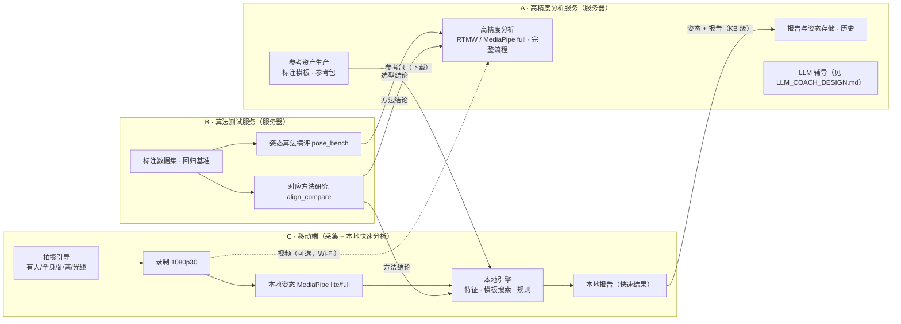

# 总体架构调整与移动端轻量方案（设计，2026-10-21）

> 目标：把系统在逻辑上分成三种角色，使本地化采集与分析可以在手机上完成，同时保留服务器端的高精度分析与算法测试能力。
> 本文是设计，不改动现有代码；精度与性能数字凡未注明“实测”的，均为估计，需按 §6 验收。

## 1. 三种角色（逻辑划分，不强制拆分部署）

| 角色 | 职责 | 运行位置（当前） | 对应已有部分 |
|---|---|---|---|
| **A 高精度分析服务** | 标准示范的标注与参考包生产；完整分析流程（最高精度姿态算法、全长识别、模板搜索、规则）；复核移动端上传的数据；报告存储与历史；LLM 辅导 | GPU 服务器测试实例 | `apps/analysis.py`、`service/`、`references/` |
| **B 算法测试服务** | 姿态算法与对应方法的横评、回归基准、标注数据集管理；为 A 和 C 的选型提供证据 | GPU 服务器开发者实例 + 远程执行脚本 | `research/`、`apps/bench.py` |
| **C 移动端轻量方案** | 拍摄引导、本地采集、本地快速分析与报告、按需上传 | 手机（新增） | 无（本文设计） |

**一套引擎规范、多种运行时**：A、B、C 共享同一组数据契约（§3）。引擎算法（特征、模板搜索、规则）在服务器用 Python 实现，在移动端移植为 TypeScript（或 Kotlin/Swift）。B 角色用同一份标注基准，检验移植版与服务器版的结果是否一致。

## 2. 移动端：能做到什么、损失多少

### 2.1 本地流程

1. **拍摄引导（实时，约 5 fps 预览分析）**：
   - 检查画面中是否有人、是否全身入画（头顶与脚下留空）、人物占画高比例（目标 ≥ 60%）、机身是否水平、光线是否充足；
   - 不达标时直接在画面上提示，从源头减少无效视频（对应本次“空镜头”与 4K 大文件问题）。
2. **录制**：1080p30 固定帧率（参数见 `VIDEO_SPEC.md` §2.1）。
3. **本地分析（录后）**：
   - 10 fps 姿态识别（MediaPipe Pose Landmarker lite 或 full，GPU）；
   - One Euro 清洗 → 14 项特征 → 段定位（2 fps 子采样粗 DTW）→ 标准模板搜索 → 规则判定 → 本地报告。
4. **上传（按需）**：默认只上传姿态与报告（每分钟约 0.1–0.3 MB）；在 Wi-Fi 下且用户同意时才上传视频，由 A 用高精度算法复核。

### 2.2 预期精度损失（依据 `POSE_BENCH.md`，同一对视频）

| 运行位置与算法 | 重复 F1 | 定势命中（以练习者 / 以标准为准） | 定势噪声 |
|---|---|---|---|
| 服务器 RTMW-x | 0.98 | 98% / 100% | 0.020 |
| 服务器 MediaPipe full（现默认） | 0.90 | 93% / 92% | 0.023 |
| 手机 MediaPipe full（同一模型，预计接近服务器） | ≈ 0.90 | ≈ 93% / 92% | ≈ 0.023 |
| 手机 MediaPipe lite | 0.84 | 86% / 83% | 0.026 |

- 同一模型在手机 GPU 上的数值应接近服务器结果，但不同 GPU 存在细小差异（I3 跨显卡实验），需实测。
- **结论**：手机用 MediaPipe full 时，对应质量约等于服务器现默认、低于服务器 RTMW。手机用 lite 时，定势命中约低 7–10 个百分点。手型、足部细节需要 RTMW 全身模型，留在服务器。

### 2.3 算力与资源（估计，需在 Pixel 7 / iPhone 14 上实测）

- 姿态：官方给出 RTMPose-s 在骁龙 865 上 13.9 ms/帧（ncnn FP16，仅模型本身）（[RTMPose](https://arxiv.org/abs/2303.07399)）。MediaPipe lite/full 在手机 GPU 上的速度需实测。按 10 fps 录后分析，5 分钟视频 3,000 帧，预计 1–3 分钟。
- 引擎：模板搜索的代价矩阵约为 150 × 1,000（每段、每个模板速率），DTW 内核在手机上为毫秒级；全片处理预计数秒。
- 参考包（§3.2）：特征与骨架约 0.3 MB；示范视频 480p 约 40 MB（5 分钟，可选、可缓存）。

### 2.4 实现路线对比

| 方案 | 姿态 | 引擎 | 优点 | 局限 |
|---|---|---|---|---|
| **PWA 网页（推荐先做）** | MediaPipe Tasks Vision for Web（WebGL GPU）（[官方 Web 指南](https://developers.google.com/edge/mediapipe/solutions/vision/pose_landmarker/web_js)） | TypeScript 移植 | 免安装，与现有前端同一技术栈；扫码即用 | 必须 HTTPS；锁屏、切后台时暂停；长视频受内存与发热限制 |
| 原生 Android（Kotlin） | MediaPipe Tasks Android 或 RTMPose（ncnn/MNN） | Kotlin 移植 | 后台上传（WorkManager）、长时间稳定、相机参数可控（固定帧率、锁曝光） | 开发量大，需单独维护 |
| 原生 iOS（Swift） | MediaPipe iOS 或系统 Vision 人体姿态 | Swift 移植 | 同上（URLSession 后台传输） | 同上；Vision 关键点定义不同，需单独验证 |
| 跨平台（Flutter / React Native） | 原生插件 | Dart / TS | 一套界面 | 姿态仍靠原生插件，调试链更长 |

**分阶段**：

| 阶段 | 内容 | 价值 |
|---|---|---|
| M1 | PWA“采集助手”：拍摄引导 + 元数据检查（分辨率 / 帧率 / 时长）+ 上传速度显示 | 解决当下的无效视频与大文件问题，几乎不涉及引擎移植 |
| M2 | PWA 本地分析：MediaPipe full + TypeScript 引擎 + 参考包 + 本地报告；上传姿态到 A 复核 | 去掉服务器往返与视频传输 |
| M3 | 原生 Android（团队现用 Pixel 7）：后台上传、长时段录制、可选 RTMPose | 满足长期、大批量的实地采集 |

## 3. 共享数据契约

### 3.1 已有（服务器端已在用）

- `PoseSequence`：时间戳（秒）、像素坐标、置信度、骨架名、镜像标志、元数据（模型 ID、设备、采样网格）。移动端产出同一结构的 JSON，模型 ID 标明 `mediapipe-web/full@<摘要>/gpu` 等。
- 报告 `motioncoach.report/0.5`：移动端产出同一 schema 的子集（不含差异模式聚类与研究字段），并标注 `"origin": "mobile"`、`"model"`。

### 3.2 新增：参考包（由 A 生成，C 下载）——生成端已实现（`motioncoach refpack`，2026-10-21）

| 内容 | 格式 | 体积（5 分钟示范） |
|---|---|---|
| `manifest.json`：参考 ID、版本、生成代码版本、对应 profile、模型 ID、内容摘要 | JSON | < 5 KB |
| `profile.yaml`：指标、容差、各式重点与不可测项 | YAML | < 10 KB |
| `segments.json`：段起止 + 标注的重复模板（起止、定势） | JSON | < 5 KB |
| `features_<model>.f16`：标准示范 10 fps 特征（14 维，float16） | 二进制 | 约 85 KB |
| `skeleton_<model>.f16`：同体型骨架（13 关节） | 二进制 | 约 160 KB |
| `video_480p.mp4`（可选）：示范视频显示代理 | MP4 | 约 40 MB |

**同一模型原则**：标准与练习者必须用同一姿态算法测量（横评显示换算法后最多约四分之一的判定改变）。因此参考包按模型分别提供特征（如 `mediapipe-lite`、`mediapipe-full`），移动端选用与本机模型一致的那份。

## 4. 服务器端的相应调整（A 与 B）

- **A**：
  - 增加参考包生成命令（从参考资产 + 标准视频生成 §3.2 各文件）；
  - 增加“移动端结果复核”入口：接收姿态与报告，用相同参考与规则复算，对比移动端结论；如有视频，再用高精度算法重算。
  - 报告与历史中标注来源（服务器 / 移动端）和模型。
- **B**：
  - 研究框架增加“移植一致性”检验：同一份姿态输入，Python 引擎与 TypeScript 引擎的重复切分、定势命中、各指标数值逐项比对（容差内一致）；
  - 横评加入“手机端实测”一栏（同一视频在手机上提取的姿态）。
- **部署**：维持“同一台 GPU 服务器、两个实例”。测试实例承担 A，开发者实例承担 B。只有在负载或安全需要时才物理拆分；本文不要求拆分。

## 5. 隐私与合规

- 默认视频不离开手机，只上传姿态与报告；上传视频需单独同意，并在服务器按 `VIDEO_SPEC.md` 的保存期删除。
- 参考示范视频的分发需取得示范者授权；参考包可以只含特征与骨架，不含视频。

## 6. 验收

| 项 | 方法 | 通过标准（初定） |
|---|---|---|
| 移植一致性 | 同一份姿态输入，Python 与 TS 引擎输出对比 | 重复切分边界差 ≤ 0.2 s；指标值差 ≤ 0.1 容差；判定一致率 ≥ 98% |
| 移动端精度 | 手机提取姿态 vs 服务器同模型，按标注基准评分 | 定势命中下降 ≤ 3 个百分点（full）/ ≤ 10（lite） |
| 性能 | Pixel 7、iPhone 14 实测 | 5 分钟视频本地分析 ≤ 3 分钟；预览引导 ≥ 5 fps；分析期间不过热降频 |
| 引导有效性 | 实地采集统计 | 无效视频（无人、半身、过远）比例显著下降 |
