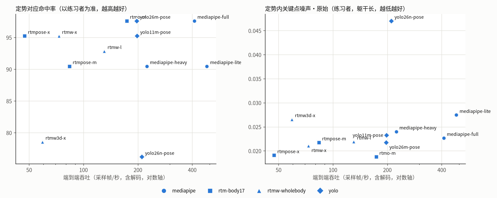
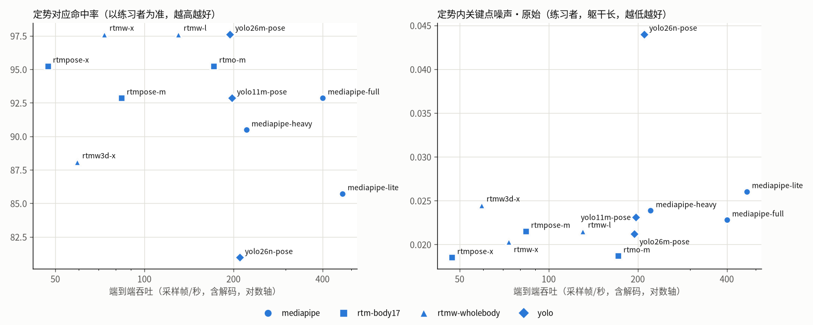

# 姿态算法横评：面向武术动作分析（2026-10-21）

> 12 个可运行的姿态算法在 GPU 服务器（RTX 4090 D）上、对同一对八段锦视频（标准 Weixin…221512 2,958 采样帧；练习者 Weixin…222517 7,088 采样帧，320×568）全长提取，每个算法独立进程、空缓存运行。
> 动作分析统一使用生产方法（特征 + 模板搜索 + 标注模板，`engine/templates.py`），以逐秒标注（`references/annotations/`）为基准。
> 复现：`uv run python -m motioncoach.research.pose_bench --out data/research/pose_bench --cache data/posebench_cache --fresh`（需 `uv sync --extra rtm --extra yolo`）；`--score-only` 复用已提取的姿态重算指标，`--plot results.json` 出图。
> 候选 3D 方法 GVHMR、SAM 3D Body 只登记未接入，不在本次横评内。
> **后续**：
> - RTMW-l 的人物框自 2026-10-23 起逐帧跟踪（`ITERATION_LOG.md` I18），本文数值为跟踪之前；
> - ViTPose++、GEM-X 的试验与 SAM 3D Body 的接入状态见 `EXPERIMENT_PLAN.md` E4。

## 0. 第二轮复测与生产选型（2026-10-21 晚，视频缓存 n3）

**设置**：同一对视频、同一脚本与标注。视频按 n3 规则重新转码（码率不超过源，见 `VIDEO_SPEC.md` §5），12 个算法各自空缓存重新提取。结果在 `data/remote/posebench-20261021-193935/`，图见下方。

**两轮对比**（下游 = 特征模板搜索 M3fa + 标注模板；“自动”= 段边界由粗 DTW 自动求出，即生产流程）

| 算法 | 重复 F1 段边界=标注 第一轮 → 第二轮 | 重复 F1 自动 | 定势命中 练习者/标准为准（自动） | 左右交替（自动） | 段边界误差 s 第一轮 → 第二轮 | 端到端 帧/秒 |
|---|---|---|---|---|---|---|
| mediapipe-full | 0.90 → 0.93 | 0.93 | 98% / 100% | 91% | 3.1 → 2.5 | 410 |
| rtmw-l | 0.94 → 0.93 | 0.89 | 86% / 100% | 96% | 5.6 → 2.8 | 130 |
| **rtmw-x** | **0.98 → 0.98** | **0.96** | 93% / 100% | **100%** | 5.4 → 5.4 | 73 |
| rtmpose-x | 0.95 → 0.98 | 0.94 | 90% / 92% | 100% | 3.5 → 2.8 | 47 |
| rtmo-m | 0.91 → 0.99 | 0.98 | 95% / 83% | 100% | 2.0 → 2.1 | 173 |
| yolo11m-pose | 0.94 → 0.95 | 0.94 | 93% / 92% | 96% | 0.7 → 1.4 | 198 |
| yolo26m-pose | 0.91 → 0.96 | 0.84 | 83% / 92% | 95% | 7.6 → 7.7 | 197 |

**读法**
- **仅转码不同，部分算法的下游指标就变化 0.03–0.08**（RTMO-m 0.91 → 0.99，MediaPipe full 0.90 → 0.93）。单个样例对上，前几名之间的差距在这一波动范围内，不能严格排序。
- **两轮都处在最前列的只有 RTMW-x**：F1 0.98 / 0.98，左右交替 100%，标准为准定势命中 100%。其他稳定的长处：滤波后定势噪声最低一档（0.0141）；有手、足关键点。弱点也稳定：
  - 自动段边界误差两轮都是 5.4 s，第六式 ↔ 第七式的边界早 15 s，在生产中导致第六式丢 2 次重复；
  - 左右标签互换最多（3.2–3.4 次/分），已被模板搜索的同侧约束吸收。
- 段边界最准的是 YOLO11m（0.7–1.4 s，AGPL）与 RTMO-m（2.0–2.1 s，头部有效率只有 66–68%），其次是 MediaPipe full（2.5–3.1 s）。

**生产选型（按环节取最准；对应模型已于同日改为 RTMW-l，见 §0b）**

| 环节 | 算法 | 依据 |
|---|---|---|
| 有无人检查 | MediaPipe lite | 只判断能否看到躯干，最快 |
| 区间定位、段边界、左右判断 | **MediaPipe full** | 许可证宽松的候选中段边界误差最小（2.5–3.1 s）；混合配置实测见下 |
| 重复对应、测量、规则判定 | **RTMW-x** | 两轮下游都最好；有手、足关键点 |
| 滤波 / 对应方法 | One Euro / M3fa（特征模板搜索） | `ALIGNMENT_STUDY.md` |

- **混合配置的验证**（研究框架，`align_compare --backend rtmw-x --bounds-backend mediapipe-full`）：
  - 端到端 F1 0.98、定势命中 95% / 100%、左右交替 100%，与“段边界 = 标注”时相同；
  - 只用 RTMW-x 时为 0.96，段内最长停滞 23.1 s，混合后 1.9 s。
- **代价**：练习者视频多一次 MediaPipe full 全长识别，12 分钟视频约 17 s（按 410 帧/秒估算，未单独计时）；标准示范已缓存。
- **生产实测**（样例练习者）：第六式与第七式的边界回到 577 s（标注 577 s），第六式检出 5/6 次。漏掉的 512–531 s 一次在研究框架中同样漏检。
- **配置**：GPU 服务器设 `MOTIONCOACH_BACKEND=rtmw-x`、`MOTIONCOACH_BOUNDS_BACKEND=mediapipe-full`；未设定时（笔记本、将来的手机端）仍全用 MediaPipe full。

## 0b. 改为精度与速度平衡的选择（2026-10-21 晚，已实施，取代 §0 的 RTMW-x）

**原则**：不为很小的精度提升付出成倍的计算量。三组证据，段边界都由 MediaPipe full 负责：

| 对应与判定所用模型 | 端到端 帧/秒 | 样例对：重复 F1 / 定势命中 练习者·标准 / 左右交替 | 翻拍测试误报（`RECAPTURE_STUDY.md`） | 备注 |
|---|---|---|---|---|
| MediaPipe full（全程） | 410 | 0.93 / 98%·100% / 91% | 8（另 1 项不可评） | 第五式大幅躯干运动下失准 |
| **RTMW-l** | 130 | 0.93 / 93%·100% / 96% | 2 | 有手、足关键点；显存 0.7 GB |
| RTMO-m | 173 | 0.99 / 98%·83% / 100% | 2 | 样例对中头部有效率仅 66–68%（第四式转头） |
| RTMPose-m | 84 | 0.91 / 90%·75% / 91% | 2 | 比 RTMW-l 慢且不更准 |
| RTMW-x | 73 | 0.98 / 95%·100% / 100% | 1 | 比 RTMW-l 慢约 1.8 倍 |
| RTMPose-x | 47 | 0.98 / 95%·83% / 100% | 0 | 最慢 |

**选择 RTMW-l**
- 相比 RTMW-x：
  - 精度：样例对中差 2 次重复（42 次中），翻拍测试多 1 项误报；
  - 速度：12 分钟练习视频的姿态识别约 55 s，RTMW-x 约 97 s（按 130 / 73 帧/秒估算）。
- 相比 MediaPipe full：速度慢约 3 倍，但在大幅躯干运动下稳定得多（翻拍误报 8 → 2）。
- 已知不足：样例练习者第七式检出 10 次（标注 6 次）。这是模板搜索把一次冲拳一分为二，属对应方法问题，研究框架中同样出现，改进见 `RECAPTURE_STUDY.md` §4 第 3 项。

**配置**：`MOTIONCOACH_BACKEND=rtmw-l`，`MOTIONCOACH_BOUNDS_BACKEND=mediapipe-full`。

以下 §1–§3 与附表为第一轮（n2 缓存）的完整记录。

## 1. 结论（第一轮）

1. **对动作分析结论影响最大的是全身模型 RTMW**。在不更换动作分析方法的前提下：
   - RTMW-x：练习者重复 F1 0.98、定势对应命中 98% / 100%、左右交替 100%；
   - RTMW-l：0.94、98% / 92%、96%。
   
   均优于现默认 MediaPipe full（0.90、93% / 92%、96%）。RTMW 还是唯一同时提供足部（跟/趾）和手指关键点的算法，可覆盖握固、攒拳等手型和提踵所需的部位。
2. **效率差一个数量级**：

   | 算法 | 端到端吞吐（帧/秒） | 显存 |
   |---|---|---|
   | MediaPipe full | 400 | 51 MB |
   | RTMW-l | 130 | 0.7 GB |
   | RTMW-x | 73 | 1.2 GB |
   | RTMPose-x | 47 | 1.9 GB |

   换算到一段 10 分钟的练习视频（6,000 采样帧），RTMW-l 约 46 s、MediaPipe full 约 15 s。在 GPU 服务器上两者都可接受；手机端或纯 CPU 场景只有 MediaPipe 可行。
3. **稳定性**：
   - 定势内关键点噪声最低的是 RTMPose-x（0.0185 躯干长）、RTMO-m（0.0187）和 RTMW-x（0.0203），MediaPipe full 为 0.0228，YOLO26n 最差（0.0440）。经 One Euro 滤波后差距缩小到 0.014–0.018，YOLO26n 仍为 0.031。
   - 左右标签互换：RTMPose / RTMO / YOLO26m 为 0 次/分，MediaPipe full 2.3、RTMW-x 3.2 次/分（左右交替动作中有影响，但被模板搜索的同侧约束吸收）。
4. **遮挡与特定动作**：
   - 第六式前屈（两手攀足）的定势中，躯干四肢关键点有效率：RTMPose-x 100%、RTMW-l 95%、RTMO-m 93%、YOLO11m 91%、MediaPipe full 85%、MediaPipe heavy 64%、RTMPose-m 59%、YOLO26n/m 约 30%。
   - 第四式转头时头部（鼻/耳）有效率：COCO-17 的单阶段模型（RTMO、YOLO）只有 67–69%（耳朵置信度低），其余 100%。头部左右转的幅度与信噪比各算法相当（约 0.36–0.43 肩宽，信噪比 79–138）。
   - 第八式提踵：所有算法的髋部起伏都低于定势噪声（信噪比 0.4–0.8）。**在 320×568 的练习者视频中，提踵对任何算法都不可测**，需要更高分辨率或侧面机位。
5. **结论稳定性**：同一套规则下，各算法的达标比例在 68%–81% 之间浮动，每个（动作段 × 指标）判定与 12 个算法多数结论一致的比例为 75%（MediaPipe heavy）至 96%（RTMPose-m、RTMW-l）。**同一份报告中，标准与练习者必须用同一个算法**；更换默认算法后历史结果不可直接比较。
6. **自动段边界**对算法敏感（平均误差 0.7–11.7 s）。YOLO11m 最好（0.7 s），MediaPipe full 3.1 s，RTMW-l 5.6 s，YOLO26n 11.7 s。本次未按段拆分误差；I3 中同类误差主要来自第八式 ↔ 收势（都以站立为主），推测这里相同。

## 2. 选型建议（第一轮，供决策；已由 §0 的生产选型取代）

| 场景 | 建议 | 理由 |
|---|---|---|
| GPU 服务器上的测试与研究 | **RTMW-l**（备选 RTMW-x） | 下游指标接近最优；130 帧/秒；有手、足关键点；Apache-2.0 |
| 追求最高精度、离线批处理 | RTMW-x 或 RTMPose-x | 下游最优 / 定势噪声最低、前屈遮挡最稳；吞吐 47–73 帧/秒 |
| 手机端、无 GPU、实时预览 | MediaPipe full | 最快、显存最小、带 3D 世界坐标；下游指标略低 |
| 需要商用 | 避免 YOLO 系列 | AGPL-3.0，商用需授权 |

是否把服务器默认算法从 MediaPipe full 换成 RTMW-l，建议在明天采集的新视频上复测后再定。差异的统计量很小：42 个定势中 1 个 = 2.4 个百分点。

## 3. 局限

- 只有一对视频、一位练习者；练习者视频分辨率很低（320×568），算法排名可能随分辨率改变。
- **关键点没有金标准**：
  - “偏离共识”只说明与多数算法不同；四个算法族中 RTMPose/RTMO 与 RTMW 同属 MMPose 系列，共识偏向这一系，附表中 RTM 系“偏离共识”最小有这一原因。
  - 定势噪声把真实的微小运动也计入。
  - 正式验收需要人工关键点标注（约 50 帧）或动作捕捉。
- 下游指标依赖同一份草标基准（±1 s，未经人工核对）。
- 显存为设备级读数（扣除基线），同机其他服务的波动会混入。MediaPipe 的显存很小是因为 GPU 委托走 OpenGL，不经 CUDA 显存分配。

## 附：完整结果（自动生成，`data/research/pose_bench/report.md`）

### 附表 1. 效率（GPU）

| 算法 | 设备 | 推理 ms/帧 | 端到端 帧/秒（含解码） | 两段视频总耗时 s | 模型加载 s | 显存峰值 MB | GPU 利用率 |
|---|---|---|---|---|---|---|---|
| mediapipe-lite | gpu | 1.6 | 467 | 22 | 0.9 | 46 | 48% |
| mediapipe-full | gpu | 2.0 | 400 | 26 | 0.8 | 51 | 55% |
| mediapipe-heavy | gpu | 4.0 | 221 | 47 | 1.9 | 73 | 72% |
| rtmpose-m | cuda | 11.6 | 84 | 120 | 0.1 | 785 | 75% |
| rtmpose-x | cuda | 20.7 | 47 | 213 | 0.1 | 1939 | 82% |
| rtmo-m | cuda | 5.5 | 172 | 59 | 0.0 | 635 | 72% |
| rtmw-l | cuda | 7.3 | 130 | 77 | 0.1 | 719 | 65% |
| rtmw-x | cuda | 13.2 | 73 | 137 | 0.1 | 1171 | 77% |
| rtmw3d-x | cuda | 16.3 | 59 | 170 | 0.1 | 1173 | 76% |
| yolo26n-pose | cuda:0 | 4.4 | 210 | 49 | 0.6 | 521 | 37% |
| yolo26m-pose | cuda:0 | 4.7 | 195 | 52 | 0.7 | 687 | 60% |
| yolo11m-pose | cuda:0 | 4.7 | 197 | 52 | 0.6 | 685 | 59% |

### 附表 2. 下游动作分析（特征 + 模板搜索 + 标注模板；段边界 = 标注）

| 算法 | 重复 F1 | 边界误差 s | 定势命中·练习者为准 | 定势命中·标准为准 | 左右交替 | 达标比例 | 判定与多数一致 | 重复间离散（容差） | 段边界误差 s（自动） |
|---|---|---|---|---|---|---|---|---|---|
| mediapipe-lite | 0.84 | 1.2 | 86% | 83% | 86% | 76% | 84% | 0.38 | 2.5 |
| mediapipe-full | 0.90 | 1.3 | 93% | 92% | 96% | 69% | 84% | 0.37 | 3.1 |
| mediapipe-heavy | 0.87 | 1.2 | 90% | 92% | 86% | 81% | 75% | 0.46 | 9.0 |
| rtmpose-m | 0.91 | 1.2 | 93% | 83% | 91% | 78% | 96% | 0.23 | 4.7 |
| rtmpose-x | 0.95 | 1.2 | 95% | 92% | 96% | 74% | 91% | 0.24 | 3.5 |
| rtmo-m | 0.91 | 1.2 | 95% | 83% | 91% | 78% | 91% | 0.33 | 2.0 |
| rtmw-l | 0.94 | 1.2 | 98% | 92% | 96% | 80% | 96% | 0.25 | 5.6 |
| rtmw-x | 0.98 | 1.1 | 98% | 100% | 100% | 78% | 91% | 0.27 | 5.4 |
| rtmw3d-x | 0.85 | 1.2 | 88% | 100% | 86% | 76% | 94% | 0.33 | 2.2 |
| yolo26n-pose | 0.87 | 1.7 | 81% | 83% | 91% | 68% | 84% | 0.53 | 11.7 |
| yolo26m-pose | 0.91 | 1.2 | 98% | 100% | 91% | 74% | 87% | 0.36 | 7.6 |
| yolo11m-pose | 0.94 | 1.3 | 93% | 100% | 96% | 77% | 87% | 0.27 | 0.7 |

### 附表 3. 稳定性与一致性

| 算法 | 定势噪声·原始（躯干长） 练习者 / 标准 | 定势噪声·滤波后 练习者 | 骨长变异（定势内） | 左右标签互换 次/分 | 偏离共识·关节中位 练习者 / 标准 | 腕 | 踝 | 指标偏离共识（容差） | 超出容差比例 |
|---|---|---|---|---|---|---|---|---|---|
| mediapipe-lite | 0.0260 / 0.0283 | 0.0186 | 6% | 2.5 | 0.039 / 0.025 | 0.064 | 0.049 | 0.18 | 5% |
| mediapipe-full | 0.0228 / 0.0258 | 0.0179 | 4% | 2.3 | 0.038 / 0.022 | 0.049 | 0.068 | 0.14 | 3% |
| mediapipe-heavy | 0.0238 / 0.0170 | 0.0161 | 4% | 0.4 | 0.030 / 0.020 | 0.039 | 0.052 | 0.12 | 2% |
| rtmpose-m | 0.0215 / 0.0180 | 0.0138 | 4% | 0.0 | 0.019 / 0.016 | 0.025 | 0.031 | 0.09 | 1% |
| rtmpose-x | 0.0185 / 0.0146 | 0.0147 | 3% | 0.2 | 0.022 / 0.015 | 0.030 | 0.038 | 0.10 | 2% |
| rtmo-m | 0.0187 / 0.0200 | 0.0150 | 4% | 0.0 | 0.034 / 0.029 | 0.038 | 0.086 | 0.08 | 1% |
| rtmw-l | 0.0215 / 0.0170 | 0.0150 | 5% | 1.9 | 0.025 / 0.016 | 0.032 | 0.039 | 0.10 | 1% |
| rtmw-x | 0.0203 / 0.0163 | 0.0138 | 4% | 3.2 | 0.022 / 0.019 | 0.028 | 0.039 | 0.08 | 1% |
| rtmw3d-x | 0.0245 / 0.0213 | 0.0174 | 5% | 1.8 | 0.023 / 0.019 | 0.029 | 0.039 | 0.08 | 1% |
| yolo26n-pose | 0.0440 / 0.0194 | 0.0314 | 6% | 0.7 | 0.044 / 0.036 | 0.075 | 0.118 | 0.15 | 5% |
| yolo26m-pose | 0.0212 / 0.0155 | 0.0158 | 4% | 0.0 | 0.033 / 0.032 | 0.032 | 0.086 | 0.11 | 1% |
| yolo11m-pose | 0.0231 / 0.0190 | 0.0156 | 5% | 1.0 | 0.039 / 0.044 | 0.033 | 0.090 | 0.16 | 2% |

### 附表 4. 覆盖与武术相关信号（练习者视频）

| 算法 | 关键点 | 检出率 | 手臂 | 腿 | 头（鼻/耳） | 足（跟/尖） | 手指 | 前屈定势（第六式）有效 | 转头定势（第四式）头部有效 | 转头幅度 / 信噪比 | 提踵（第八式）髋部起伏 / 信噪比 | 3D | 许可 |
|---|---|---|---|---|---|---|---|---|---|---|---|---|---|
| mediapipe-lite | 33 | 100% | 98% | 99% | 100% | 95% | — | 90% | 100% | 0.40 / 103.5 | 0.015 / 0.6 | 是 | Apache-2.0 |
| mediapipe-full | 33 | 100% | 98% | 99% | 100% | 100% | — | 85% | 100% | 0.40 / 80.1 | 0.012 / 0.5 | 是 | Apache-2.0 |
| mediapipe-heavy | 33 | 100% | 94% | 94% | 100% | 71% | — | 64% | 100% | 0.38 / 119.4 | 0.010 / 0.4 | 是 | Apache-2.0 |
| rtmpose-m | 17 | 98% | 98% | 98% | 98% | — | — | 59% | 100% | 0.40 / 80.1 | 0.015 / 0.7 | — | Apache-2.0 |
| rtmpose-x | 17 | 100% | 100% | 100% | 100% | — | — | 100% | 100% | 0.36 / 101.8 | 0.015 / 0.8 | — | Apache-2.0 |
| rtmo-m | 17 | 100% | 100% | 100% | 80% | — | — | 93% | 67% | 0.38 / 138.0 | 0.015 / 0.8 | — | Apache-2.0 |
| rtmw-l | 133 | 100% | 99% | 100% | 99% | 100% | 99% | 95% | 100% | 0.38 / 79.2 | 0.017 / 0.8 | — | Apache-2.0 |
| rtmw-x | 133 | 100% | 99% | 100% | 99% | 99% | 99% | 87% | 100% | 0.37 / 82.7 | 0.013 / 0.6 | — | Apache-2.0 |
| rtmw3d-x | 133 | 100% | 98% | 99% | 99% | 99% | 96% | 78% | 100% | 0.37 / 97.9 | 0.017 / 0.7 | 是 | Apache-2.0 |
| yolo26n-pose | 17 | 97% | 96% | 96% | 88% | — | — | 33% | 68% | 0.41 / 118.4 | 0.019 / 0.4 | — | AGPL-3.0 |
| yolo26m-pose | 17 | 96% | 96% | 96% | 88% | — | — | 29% | 69% | 0.41 / 123.2 | 0.017 / 0.8 | — | AGPL-3.0 |
| yolo11m-pose | 17 | 99% | 99% | 99% | 90% | — | — | 91% | 69% | 0.43 / 96.0 | 0.015 / 0.6 | — | AGPL-3.0 |

说明：
- 推理 ms/帧 为模型调用本身（不含解码，去掉前 3 帧预热）；端到端 帧/秒 含视频解码与采样，两段视频共约 1 万采样帧。显存峰值为设备级（nvidia-smi），已扣除运行前基线，同机其他进程的波动会混入。
- 定势噪声：标注的定势区间内，同体型骨架 13 个关节坐标去线性趋势后的标准差（躯干长）；定势中人体近似静止，此值主要反映关键点抖动。骨长变异：定势内上臂/前臂/大腿/小腿长度的变异系数。
- 共识：四个算法族（MediaPipe、RTMPose/RTMO、RTMW、YOLO）各取族内中位数后再取中位数；偏离共识只说明“与多数算法不同”，不等于误差。
- 判定与多数一致：每个（动作段 × 指标）的状态与 12 个算法多数结论相同的比例。重复间离散：各式重点指标在 6 次重复上的定势偏差标准差 / 允许偏差（含练习者真实的动作差异）。
- 转头幅度：第四式标注定势内头部左右转（肩宽）中位数；信噪比 = 幅度 / 第四式逐帧差分的稳健标准差（1.4826×MAD）。提踵：第八式内髋部竖直位置 0.4–4 s 尺度波动（躯干长），信噪比相对定势噪声。
